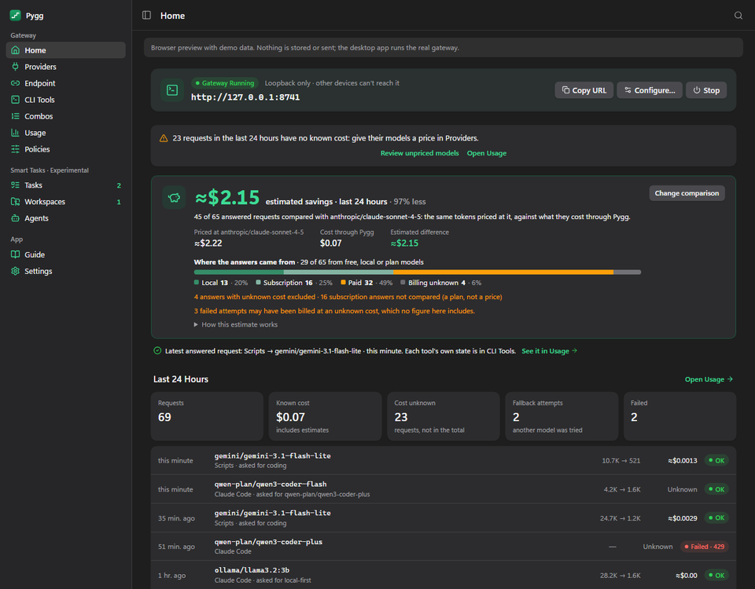
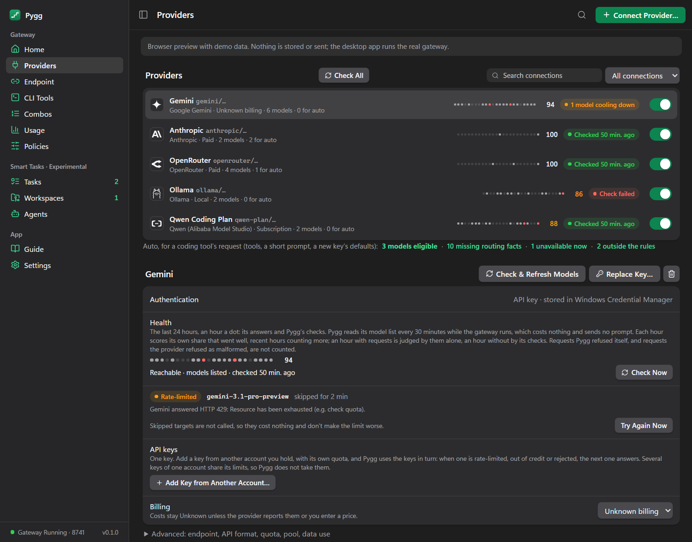
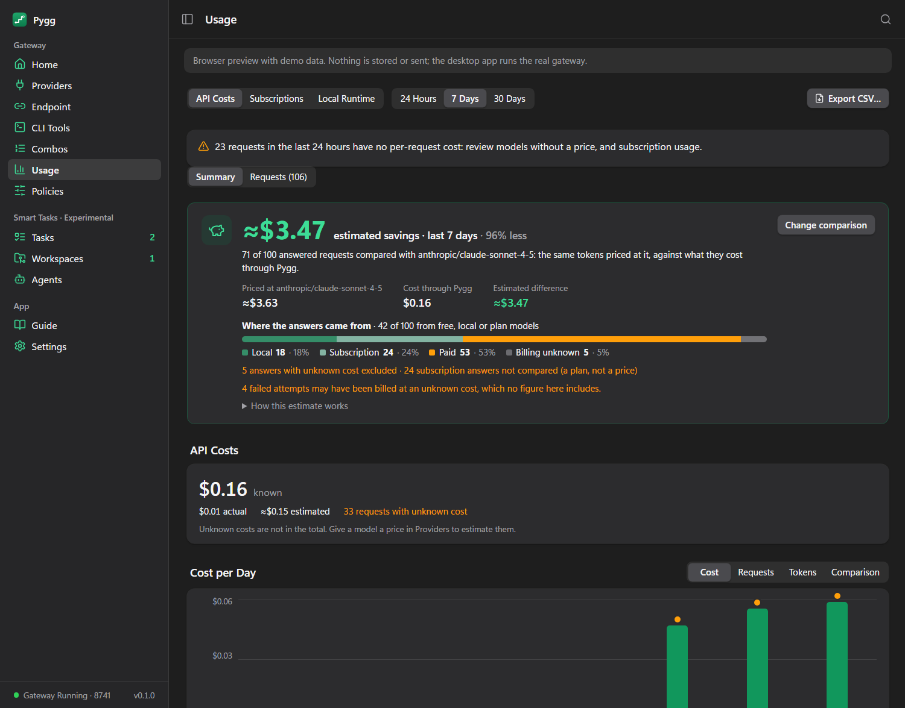
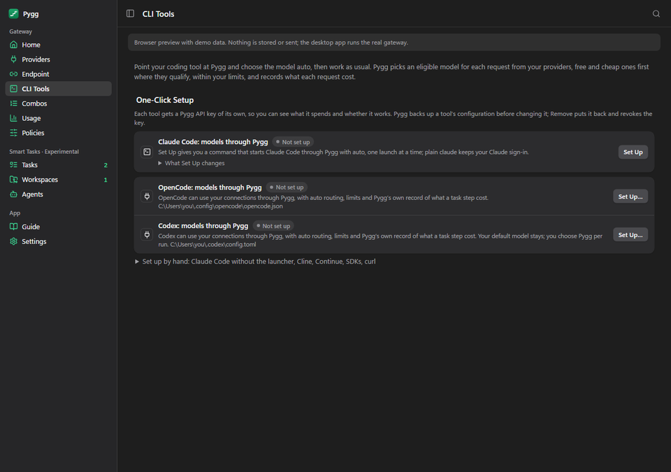

<p></p>

# Pygg

**One Flow. Many Agents.** A local AI gateway that cuts what your coding tools cost.

[](https://github.com/nambean/smarttaskrouter/actions/workflows/ci.yml)   

<p></p>

The repository and its technical identifiers keep the engineering name SmartTaskRouter. New here? Read [Getting started](docs/GETTING-STARTED.md). Every document is listed in [docs/README.md](docs/README.md); brand assets are in [branding](branding/README.md).

Pygg runs on your computer. You connect your providers once, point Claude Code, Codex, OpenCode, an editor or an SDK at it, and choose the model `auto`. Each request then goes to an eligible model you connected, free and cheap ones first where they qualify, within the limits you set. Every request is recorded with what it cost and where that figure came from. The app hosts no chat of its own (ADR-028).

> **Status (2026-11-14), developer preview for Windows x64:**
> - **Built and live-verified:** the gateway and the desktop app that runs it, from first launch to "my coding tool uses `auto`".
> - **Built and fake-tested:** account pools, web-session connections for AI sites without an API, the `pygg` command line (npm developer preview), estimated savings, the token mix and routing diagnostics, and automatic prompt caching for translated agent turns.
> - **On hold:** smart tasks, run by agent CLIs and started from an IDE, work but are paused until the owner re-evaluates them.
>
> See [implementation status](docs/IMPLEMENTATION-STATUS.md) and the [roadmap](docs/ROADMAP.md). Installers are not code-signed yet, so Windows SmartScreen warns about them.
>
> **Not yet for unattended or financially critical use:** spending limits rely on prices and token estimates, and clean-machine installation and long-running behaviour need more validation ([production readiness](docs/reports/2026-11-14-production-readiness.md)). Web sessions are optional, unofficial and experimental; automated use can lead to account restrictions.

## What makes Pygg different

- **Cost you can trace.** Every request is recorded with its cost and where that figure came from: actual (the provider said), estimated (a price you or a catalog set) or **unknown**, never shown as $0. Savings are an estimate against a model you choose, with what was left out said beside it.
- **It keeps the provider's cache working.** A coding agent re-sends its whole conversation every turn; the provider's prompt cache bills that at a tenth or less. Pygg keeps a launch on one model, passes cache hints through unchanged, turns on Anthropic's caching for clients that cannot ask for it, and shows the token mix so you can see it working ([ADR-036](docs/DECISIONS.md)).
- **Setup you can undo.** Each tool gets its own key; its configuration is backed up first and Remove puts it back. Claude Code keeps your Claude sign-in: `pygg run claude` routes one launch at a time.
- **Local, with your own accounts.** Keys stay in the Windows Credential Manager, the gateway listens on 127.0.0.1 only, and Pygg contacts nothing but the providers you connected and a public model catalog.

| Providers | Usage | CLI Tools |
| --- | --- | --- |
|  |  |  |

Screenshots are the browser preview with demo data.

## How it works for a user

The setup follows 9router and OmniRoute, so it feels familiar:
1. **Install and open Pygg.** The gateway starts on `127.0.0.1:8741`. Home shows three steps.
2. **Providers → Connect Provider.** Pick a provider and paste its key; Pygg reads its model list. Gemini, OpenRouter and Groq have free tiers, and Ollama runs locally. AI sites with no API connect as web sessions.
3. **CLI Tools.**
   - Codex and OpenCode are set up in one click: backup, a key of their own, the change, a check.
   - Claude Code starts through Pygg with `pygg run claude`, one launch at a time, so your Claude plan stays as it was.
   - Editors and SDKs get a snippet.
4. **Work as usual with the model `auto`.** Home shows the first request, what it cost, and an estimate of what it saved against the model you would otherwise use.

Step by step, with each tool's commands and a troubleshooting table: [Getting started](docs/GETTING-STARTED.md).

## What works today

- **Gateway on `127.0.0.1:8741`:**
  - OpenAI Chat Completions, OpenAI Responses (for Codex) and Anthropic Messages, streamed, with tool calls in both directions.
  - Loopback only.
  - One gateway per store.
- **Providers:**
  - 26 cloud presets and 6 local runtimes ([PROVIDERS.md](docs/PROVIDERS.md)), plus custom OpenAI- and Anthropic-compatible endpoints.
  - Keys stay in the Windows Credential Manager.
  - Model facts (prices, context, tools) are looked up from the models.dev catalog.
  - Quota windows and account balances are shown where the provider reports them.
- **Same-format passthrough:** an Anthropic request (Claude Code) to an Anthropic connection goes through unchanged, so its prompt cache keeps working. Other pairs are translated and report what they drop.
- **`auto` and `auto/cheap`:**
  - Rules over the models you connected, not a classifier.
  - `auto` takes the lowest eligible tier at or above the key's minimum; `auto/cheap` takes the lowest estimated cost.
  - Unknown facts count as missing.
  - Every response says why it chose what it chose.
  - **How auto chooses** (in Combos) simulates a route.
- **Combos:**
  - A name such as `coding` stands for an ordered list.
  - The order is either as listed or **cheapest first** for each request.
  - Templates build one from rules: Free first, Use my plans first, Strong coding with cheap backup, Local only, Long-context, and others. They never fill a gap with a paid model by themselves.
  - Fallback happens only before any answer reaches the client, and it honours cooldowns and shared quotas.
- **Pools ([ADR-034](docs/DECISIONS.md)):**
  - Separate API-key accounts of one provider behind one name.
  - Web sessions of one site may pool too. Such a pool sends each request to the account used least today, and each account keeps its own limit and pace.
- **Web sessions ([ADR-035](docs/DECISIONS.md)):**
  - **Opt-in and unofficial.** Each one is behind an account-risk warning you accept.
  - **Sites:** Muse, ChatGPT, Perplexity, DeepSeek and Grok.
  - **Sign-in and storage:** you sign in yourself in Pygg's own window. Each connection keeps its own profile, and Pygg never imports cookies.
  - **Where Pygg types:** only on the site's own page.
  - **Pace:**
    - one request at a time;
    - a 10 s rest between requests;
    - a daily limit (50 by default).
  - **What it never does:** it never changes the browser's fingerprint and never answers a CAPTCHA.
  - **Cost:** $0 a request by default, since the site is used on your own plan; set it to Subscription to count requests as quota instead.
  - **Benchmark:** 47 of 48 short tasks answered correctly, at about 18 s each ([report](benchmark/reports/2026-11-13-web-sessions.md)).
- **API keys:**
  - One per app, each with:
    - a monthly limit (estimated or strict);
    - a cap on requests in flight;
    - a policy for models without a price;
    - the connections it may use;
    - a minimum tier for `auto`.
  - A copy of each key is kept in the Credential Manager, so it can be shown again. Revoked keys can be deleted.
  - **Policies** sets the defaults for new keys.
- **Usage:**
  - Every attempt is recorded with its cost and that cost's source: **actual**, **estimated** or **unknown**, never shown as $0.
  - Estimated savings compare the same tokens at a model you choose, and say what was left out.
  - Charts, alerts, CSV export and retention.
  - **Token mix** (new input, cache reads, cache writes, output) and **Routing** (fallbacks, routing sessions, changes of model with the cache writes that followed); each request records its attempt chain, the billing it was sent under and what happened to its cache hints.
- **CLI (`pygg`, or `pygg-cli.exe` next to the app):**
  - `pygg` alone shows where you are; `setup claude|codex|opencode`, `run claude|codex|opencode` (a routing session per launch), `status`, `doctor`, `providers`, `models`, `logs`, `usage` (each with `--json`), `gateway …`, `diagnostics` and `mcp` ([design](docs/design/CLI.md)).
  - npm developer preview: `npm install -g @pygg/cli@dev`.
- **Guide:** in the app, with every command ready to copy.
- **Smart tasks (experimental, on hold):**
  - IDE agents hand subtasks to Pygg over MCP.
  - Agent CLIs run them in worktrees against approved checks.
  - Paid steps wait for approval in the app ([AGENTS.md](docs/AGENTS.md)).

## Navigation

| Group | Screen | Purpose |
| --- | --- | --- |
| Gateway | Home | Gateway state, the three setup steps, estimated savings, the last 24 hours |
| | Providers | Connections, keys or sign-ins, models, prices, health and quota |
| | Endpoint | Base URLs to copy, and API Keys with their limits |
| | CLI Tools | One-click set-up for Codex and OpenCode, the Claude Code launcher, snippets for the rest, each tool's status |
| | Combos | Combos and templates; How auto chooses |
| | Usage | Savings, costs, requests, alerts, export |
| | Policies | Defaults for new keys, each key's and each connection's policy, the guarantees |
| Smart Tasks · Experimental | Tasks, Workspaces, Agents | On hold |
| App | Guide, Settings | How to use Pygg, the commands; preferences, background, diagnostics |

See the [screen design](docs/design/SCREENS.md).

## Tech stack

- **Tauri 2** with a Rust core: the gateway (axum), the task engine, a SQLite store, the OS credential store, WebView2 windows for web sessions, and process supervision.
- **Interface:** React 19 + Vite + TypeScript with semantic CSS tokens.
- **Workspace:** pnpm.

## Development

Requirements:
- Node.js LTS and pnpm 9 (`corepack enable`).
- Stable Rust, installed through rustup.
- On Windows, the Visual Studio C++ Build Tools and WebView2. WebView2 is built into Windows 11.

Run these from the repo root:

```powershell
pnpm install
pnpm dev                                              # interface in a browser at http://127.0.0.1:1431 with demo data (?empty for first run)
pnpm --filter @smarttaskrouter/desktop tauri:dev     # the desktop app with the real gateway
pnpm typecheck
pnpm --filter @smarttaskrouter/desktop tauri:build   # NSIS and MSI installers under src-tauri/target/release/bundle
cd apps/desktop/src-tauri; cargo test --lib           # core, gateway, web-session and task engine tests
```

`PYGG_DATA_DIR` points the app at another store, for trying it without touching your own. In a debug build, `PYGG_WEB_DEVTOOLS=1` turns on a navigation log and DevTools for web-session windows.

### Command line

`pygg-cli` (or `pygg` from npm) uses the same core and store as the app. API keys are read from an environment variable, so they never appear on a command line.

```powershell
pygg                               # where you are, and what to type next
pygg setup claude                  # route Claude Code through Pygg; also codex, opencode
pygg run claude                    # start it through Pygg, a routing session per launch
pygg providers                     # saved connections: on, last check, health, models
pygg models --search flash         # the models to ask for, with billing and price
pygg logs --failed                 # recent request attempts that did not answer
pygg usage --days 7 --json         # requests, cost and token mix, for scripts
pygg gateway add-connection --preset gemini --key-env GEMINI_API_KEY
pygg gateway auto --alias auto --tools yes   # which model auto would choose, and why
pygg --help
```

More is in the in-app **Guide** and in [AGENTS.md](docs/AGENTS.md).

## Licence

MIT, see [LICENSE](LICENSE). Third-party notices are in [THIRD_PARTY_NOTICES.md](THIRD_PARTY_NOTICES.md).

## Documentation

**Using Pygg**

- [Getting started](docs/GETTING-STARTED.md): install, first run, connect a provider, set up Claude Code, Codex, OpenCode or an editor, see cost and savings, troubleshooting, FAQ.
- [Providers](docs/PROVIDERS.md): every connection preset, its endpoint, its free tier and whether it has answered live; the web-session sites.
- [Security](docs/SECURITY.md): what Pygg protects, what you are trusted with, how to report a problem.
- The in-app **Guide** repeats the steps with every command ready to copy.

**Engineering**

- [Implementation status](docs/IMPLEMENTATION-STATUS.md): what is built and how each part was verified, including what is not verified yet. The authority on whether something works.
- [Roadmap](docs/ROADMAP.md): delivery order and release gates. The authority on what comes next.
- [Architecture](docs/ARCHITECTURE.md), [Decisions](docs/DECISIONS.md) (ADR-001 to ADR-035), [Schema](docs/SCHEMA.md), [Agents and smart tasks](docs/AGENTS.md).
- [Contributing](CONTRIBUTING.md): how to change Pygg.
- [Benchmarks](benchmark/reports): each run with its method, cost and raw results.
- [Reviews](docs/reviews) with their answers, and [research](docs/research), as written at the time.
- [docs/README.md](docs/README.md): the full index, grouped by reader, with each document's status.
