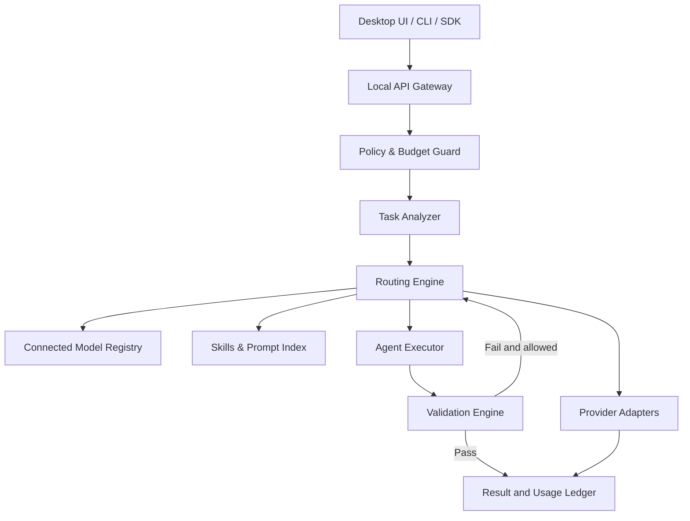

# SmartTaskRouter — UI/UX & Functional Implementation Plan

> Version: 1.0 | Date: 2026-11-10 | Status: product/design specification, no production code
>
> Reference direction: 9Router-style desktop management UX with additional task-aware model and agent orchestration.

## 0. Product scope and principles

**Goal:** intelligently route a user's task to the most suitable *connected* model, coding agent and curated prompt/skill, using free or locally hosted inference wherever quality allows.

**Principles:** connected-model-first; free-first but quality-gated; user confirmation on paid escalation; transparent routing; minimum necessary context; security-first skill handling; usage-based optimization; reversible settings.

**Non-goals for MVP:** full IDE replacement, arbitrary website agent browsing, marketplace monetization, cloud orchestration at scale, guaranteed free execution or guaranteed savings.

**Competitive distinction:** 9Router-style provider/quota/endpoint management plus task understanding, context-aware routing, explainable model selection, skill recommendation and validation-driven escalation.

## 1. UI design system

- Desktop-first, 1440×900 baseline; responsive down to 1024px; macOS-style window chrome where applicable.
- Default light: background `#F8FAFC`, surface `#FFFFFF`, text `#111827`, border `#E5E7EB`.
- Accent orange `#F97316`, hover `#EA580C`, success `#16A34A`, warning `#D97706`, error `#DC2626`.
- 8px spacing rhythm, 10–16px radii, Geist/Inter with Vietnamese glyph support; dark theme available.
- Shell: fixed sidebar, header with gateway status/workspace/provider status, command palette `Ctrl/Cmd+K`, notifications.
- System-wide visual states: skeleton/loading; empty; offline; auth error; quota exhausted; forbidden by policy; degraded; failure; success.
- Accessibility: focus visible, keyboard workflow, AA contrast, icons paired with labels and reduced motion support.
- Routing badges: `Free`, `Local`, `Paid`, `Unknown`; these are not equivalent to quality or operational cost.

### Navigation

Overview · Smart Routing · Providers · Models · Model Combos · Agents · Skills & Prompts · Task History · Usage & Analytics · Routing Rules · CLI & Endpoints · Settings.

### Design mockups

- `smart-routing.png` — task entry, classifier result, model/agent/skill suggestion.
- `providers.png` — provider connections and catalog state.
- `model-combos.png` — routing pipeline, budget and fallback configuration.
- `overview-boards.png` — overview of proposed pages and roadmap.

The mockups contain illustrative model names, quotas and costs; they are not real provider readings or measured performance data. Store actual assets under `docs/design/` when binary uploads are available.

## 2. Screen-by-screen UX specification

### 2.1 Overview

**Cards:** gateway health, number of active providers, available models, total tasks, total estimated/actual spending, success rate and free/local usage share.

**Panels:** recent tasks, provider quota health, routing distribution, top skills, warnings and onboarding checklist.

**Actions:** connect provider, open Smart Routing, inspect a recent execution, view gateway endpoint.

**Empty state:** onboarding wizard rather than zeroed-out statistics. No fabricated savings numbers.

**Acceptance:** KPIs reconcile with event ledger; unknown usage is explicitly labeled; data refresh and errors visible.

### 2.2 Smart Routing

**Input:** multiline task, optional project/workspace, attachments/context permissions, strategy `Free First | Balanced | Quality`, custom policy.

**Analysis:** intent/category, complexity, tool/function calling needs, requested language/framework, context size, risk, potential stage breakdown.

**Recommendation:** stage-by-stage proposed agent/model, selected connected provider, candidate alternatives, skill suggestions, estimated token/cost range, expected checks and escalation criteria.

**Controls:** optimize prompt (preview/undo), select alternative model, enable/disable suggested skills, edit stage, confirm paid execution, run, cancel.

**Important:** a route recommendation is not a guarantee of task success. No execution until user authorizes external or paid actions under policy.

**Error states:** no provider, insufficient quota, model capabilities mismatch, unsupported tool calling, estimation unavailable, timeout, policy denial.

**Acceptance:** an explainable, editable route is produced from connected models only; free-first does not select an incapable free model; billing gates are honored.

### 2.3 Providers

**Layout:** cards or table showing provider, connection status, auth type, account label, number of models, quota, health, latency and last check.

**Operations:** connect/reconnect, test, rotate credentials, disable/remove, sync model catalog, inspect quota errors.

**Provider types:** OpenRouter, Anthropic, OpenAI, Google Gemini, Ollama/local and user-defined OpenAI-compatible endpoints.

**Security:** encrypted-at-rest credentials; masked secrets never returned to frontend; no keys in logs/telemetry; optional OS keychain.

**Acceptance:** connection tests don't expose secrets; transient API outage is distinguishable from invalid credentials.

### 2.4 Models

**Catalog filters:** provider, free/local/paid/unknown, input/output price, tool calling, structured outputs, reasoning, context length, vision, streaming, availability.

**Model details:** exact provider identifier, version, capability provenance, freshness of price/quota metadata, measured reliability/latency, policy restrictions.

**Actions:** favorite, disable model, test with consent, assign to a combo, compare candidate models.

**Acceptance:** stale pricing is labeled as such; a model with unknown capabilities is not assumed suitable for function calls.

### 2.5 Model Combos

**Default strategies:** Free First Coding, Balanced Development, Deep Architecture; user can duplicate and customize.

**Pipeline:** Classify → Select → Execute → Verify → Retry or Escalate.

**Settings:** task patterns, primary/fallback/verifier candidates, maximum tries, latency target, token budget, daily/monthly monetary limits, paid approval threshold, allowed providers, minimum confidence.

**Conditions:** tool availability, context window, data privacy, quota, model health and expected repair cost.

**Acceptance:** invalid or cyclic fallback routes rejected; policy changes versioned; test/simulate using synthetic examples.

### 2.6 Agents

**Agent registry:** Claude Code, Codex, OpenCode and other explicitly supported CLI/IDE integrations, with capabilities, version and connectivity tests.

**Workspace:** task timeline, stages, delegated subtask ownership, stage status, stdout/stderr excerpts with redaction, artifact links and approval checkpoints.

**Controls:** pause/cancel where supported, retry one failed stage, use alternative agent, inspect context and execution trace.

**Acceptance:** agents never receive more filesystem/network permission than granted; process termination and partial results handled.

### 2.7 GitHub Skills & Prompts Hub

**Tabs:** Discover, Skills, Prompts, Agents, Installed, My Library.

**Discovery:** sync curated repositories and community indexes; index repository/license/commit/source metadata; semantic matching against current task and stack.

**Suggestion ranking:** relevance, agent compatibility, version freshness, trust tier, permissions, install footprint, user feedback.

**Detail pane:** README/SKILL.md preview, source commit, license, required tools and permissions, security warnings, install scope.

**Installation:** preview contents and permissions, require confirmation, pin version/hash, allow update, rollback and uninstall; never auto-execute untrusted scripts.

**Prompt use:** preview → customize → attach to current task; progressive disclosure to avoid injecting hundreds of unused tokens.

**Acceptance:** provenance and trust clearly shown; repository content treated as untrusted instructions.

### 2.8 Task History

**Table:** task title, time, workspace, policy, route, agent, token count, input/output/cache token details, actual cost, duration and outcome.

**Detail:** original request with redaction, classifier output, routing explanation, stage logs, validation results, retries, model changes and estimates vs actual.

**Actions:** rerun with confirmation, duplicate route, export redacted trace, compare two executions.

**Acceptance:** canceled/failed tasks and partial billable calls are included in actual usage.

### 2.9 Usage & Analytics

**KPIs:** task success rate, effective cost per successful task, total spend, free/local ratio, model latency p50/p95, tool failure rate, retries/escalations, cache effectiveness.

**Views:** by project, day, provider, model, agent, combo and task category; budget alerts and cost anomaly detection.

**Cost comparison:** compare a reproducible baseline, not unverified claimed savings; track infrastructure cost separately for local inference.

**Acceptance:** usage and costs reconcile with provider response and auditable event ledger, with estimated/unknown clearly separated.

### 2.10 Routing Rules

**Hierarchy:** global defaults → workspace overrides → task-specific exceptions, with most-restrictive security constraints always applying.

**Policies:** free-first mode, paid escalation approval, daily caps, allowed models, sensitive data locality, tools and skills allowlists, retry policy, provider fallback, context cap and redaction.

**Testing:** dry-run simulator and policy conflict diagnostics; explain which rule decided the final route.

**Acceptance:** deny/approval conditions cannot be bypassed by subagents or retries.

### 2.11 CLI & Endpoints

**Endpoint modes:** gateway pass-through, policy-routed model alias, and optional task-orchestration endpoint; keep semantics distinct.

**Clients:** example configuration for compatible OpenAI/Anthropic SDKs and supported coding CLIs; show health/version and local address.

**Credentials:** separate scoped client tokens, rotation/revocation, per-client budgets and IP bind defaults.

**Acceptance:** streaming, abort, usage, retry semantics and errors are compatible with advertised endpoint contracts.

### 2.12 Settings

Appearance, language, updates, data directory, telemetry opt-in, model/catalog sync cadence, local inference runtime, data retention, log redaction, backup/export, diagnostics, app startup and API binding.

## 3. Core routing system

### 3.1 Functional pipeline

1. Receive task + workspace + user strategy + hard policy.
2. Normalize task and perform deterministic checks for explicit constraints.
3. Classify intent/complexity with heuristics or local classifier; use a small connected model only if needed and budget-allowed.
4. Estimate minimum required capability, tool calls, context length, model reliability and cost range.
5. Build eligible candidate set from live provider/model registry.
6. Rank by expected cost for a *validated successful result* subject to quality/privacy/budget/latency constraints.
7. Recommend route, stage breakdown, agent and skill candidates with rationale.
8. Obtain approval if the policy requires it; execute and stream events.
9. Validate outputs with deterministic tests and user-defined checks when possible.
10. Retry narrowly, escalate only if justified and allowed; persist actual token/monetary ledger.

### 3.2 Candidate filtering

Never route to disabled, disconnected, exhausted, incompatible or disallowed models. `Free` status requires currently verified pricing/entitlement; `Local` has non-API operational cost. Tool calls, schema support, privacy class and context length are hard eligibility checks.

### 3.3 Ranking objective

Optimize expected total cost per successful task, not raw token price:
`expected_total = inference + retries + tool_overhead + context + validation + expected_escalation + local_operating_cost`.

Quality scores must be calibrated and progressively improved from validation data, not invented.

### 3.4 Escalation rules

- Start with low-cost eligible models for bounded, reversible work.
- For difficult/high-risk tasks, route directly to an appropriately capable model.
- Validate using compile/lint/unit tests, schema/contract checks and independent review where appropriate.
- Allow bounded retries; avoid repeating identical failures.
- Require explicit confirmation when paid escalation exceeds configured permission/threshold.
- Store a reason for every route and model switch.

### 3.5 Context optimization

Repo/file retrieval scoped to relevant paths, hash-based caching, compact task summary, no redundant agent transcript copies, skill prompt progressive loading, maximum per-stage token allocations and privacy-aware redaction.

## 4. Proposed technical architecture



### Suggested stack

- Desktop: **Tauri 2** + React, TypeScript, Vite, Tailwind/shadcn; system-keychain integration where available.
- Local backend/gateway: Node.js TypeScript (Fastify) or Rust adapter for security-critical processes; streaming SSE/WebSocket as appropriate.
- Model provider adapters: LiteLLM-inspired adapters or compatible SDKs, with explicit per-provider capability metadata. Evaluate license and operational complexity before adoption.
- Persistence MVP: SQLite for single-user desktop; optional PostgreSQL and Redis only if multi-user hosted mode is introduced.
- Worker processes: bounded CLI subprocess supervisor with per-task isolation and cancellation.
- Skill ingestion: GitHub metadata sync, parser, lexical search initially, embeddings as optional upgrade.
- Observability: structured traces, token/cost ledger and opt-in diagnostics; never upload secrets or raw prompts by default.

### Service modules

`connection-service`, `model-catalog`, `quota-service`, `task-analyzer`, `router`, `policy-engine`, `skill-index`, `agent-runner`, `validation`, `usage-ledger`, `gateway`, `settings`.

## 5. Data model (logical)

| Entity | Primary fields |
| --- | --- |
| providers | id, type, endpoint, enabled, health, credential_ref |
| models | id, provider_id, model_id, capabilities, context, price, status, observed_at |
| quotas | provider_id, model_id, remaining, reset_at, source, observed_at |
| workspaces | id, name, path, policy_id |
| routing_policies | id, scope, strategy, budget, fallback, version |
| combos | id, name, stages_json, enabled, version |
| tasks | id, workspace_id, prompt_ref, status, policy_snapshot, created_at |
| task_stages | id, task_id, agent_id, model_id, attempt, status, validation |
| route_decisions | id, task_id, eligible, excluded_reasons, score_inputs, chosen |
| usage_events | id, stage_id, provider, model, input/output/cache_tokens, cost, status |
| skills | id, repo_url, ref, path, hash, license, trust, permissions |
| skill_installs | id, skill_id, workspace_id, pinned_hash, approved_permissions |
| agent_connections | id, type, executable, version, capabilities, enabled |
| approvals | id, task_id, action, estimated_cost, outcome, timestamp |
| audit_events | id, actor, action, entity, metadata_redacted, timestamp |

Use immutable per-task policy and model snapshots for historical reproducibility. Keys must never appear in these tables in plaintext.

## 6. API contracts (draft)

| Method | Path | Purpose |
| --- | --- | --- |
| GET | /api/health | Gateway readiness and version |
| GET/POST | /api/providers | List/create connections |
| POST | /api/providers/:id/test | Test provider |
| POST | /api/providers/:id/sync | Refresh model/catalog/quota |
| GET | /api/models | Filter model capabilities and costs |
| GET/POST | /api/combos | Configure named model routes |
| GET/POST | /api/policies | List/create routing policies |
| POST | /api/routes/analyze | Classify request and suggest plan |
| POST | /api/routes/simulate | Dry-run model selection without execution |
| POST | /api/tasks | Approve and start planned task |
| GET | /api/tasks/:id | Task state and output |
| GET | /api/tasks/:id/events | Stream stage and usage events |
| POST | /api/tasks/:id/cancel | Request cancellation |
| GET | /api/skills/search | Discover relevant skills |
| POST | /api/skills/install | Review and install pinned skill |
| GET | /api/usage | Usage and budget analytics |
| GET | /api/agents | Available CLI/IDE agent adapters |

Version endpoint contracts, validate all request schemas, provide idempotency keys on task creation, preserve safe cancellation semantics, support request-scoped budgets and rate limits. Existing OpenAI/Anthropic-compatible paths must be implemented and tested per advertised compatibility.

## 7. Security and privacy

- Encrypt API keys at rest with OS-protected secrets where available; limit privileged APIs to loopback by default.
- Explicit user permission required for workspace files, shell commands, networking and destructive actions.
- Third-party skills are untrusted; inspect references, scripts, network requests and tool permissions; pin hashes.
- Prompt injection defense: repository content and external pages are data, not instructions; enforce tool boundary.
- Separate model inference from tool execution; redact secrets, tokens and sensitive paths in traces.
- Paid model usage obeys per-task, daily and workspace budget limits; unknown price cannot be treated as free.
- Secure update channel, signed binaries and dependency checks prior to public release.
- No credential-sharing or attempts to bypass provider limits or plan terms.

## 8. QA & acceptance scenarios

1. First-run without provider shows useful guided empty state.
2. Free-first chooses an eligible connected free model for a simple request; never an unsupported free model.
3. Hard tool calling or context requirements exclude incompatible models.
4. Quota exhaustion triggers only permitted fallback; dashboard shows why.
5. Paid escalation waits for approval if policy requires it.
6. No connected provider results in actionable guidance, not a fabricated route.
7. Untrusted GitHub skill requests shell/network privileges and requires explicit review.
8. Per-task ledger includes failed attempts and partial billable calls.
9. Concurrent tasks never exceed shared budget.
10. Agent cancellation terminates bounded process and records incomplete stage.
11. Gateway stream and error mappings pass supported-client contract tests.
12. Privacy/redaction tests ensure no credentials or sensitive prompt data leak.
13. Recovery after crash preserves task history, approvals and accurate usage state.
14. Analytics compare verified costs without asserting fictional savings.

## 9. Roadmap and deliverables

### Phase 1 — Core MVP (P0)

- Tauri shell; shared design tokens, sidebar and navigation.
- Provider connections, secure secrets, model catalog and health checks.
- Basic compatible gateway, streaming and cancellation.
- Task analyzer (heuristic/local-first), Free-first/Balanced/Quality router.
- Smart Routing screen, model suggestion, editable route, simulated dry run.
- Minimum usage ledger, quotas and budget confirmation.
- Automated provider adapter tests and initial packaged desktop build.

**Exit:** connect 2+ provider types, route an actual simple task to a capable connected model, show accurate cost/usage and explain decision.

### Phase 2 — Skills & Agents (P1)

- GitHub skill discovery, metadata indexing, relevance ranking, preview and pinned installs.
- Skill permission reviews and workspace skill library.
- CLI agent detection/adapters, supervised execution, stage task traces.
- Stage-level validation, retry and approval-based escalation.
- Agent Workspace and Task History screens.

**Exit:** execute a multi-stage coding task with an approved skill, auditable stage model choices and tests.

### Phase 3 — Cost & Context Optimization (P1)

- Scoped repo retrieval and context reuse/cache.
- Routing benchmarks and empirical capability scores.
- Per-model observed reliability/latency; cost-per-success analytics.
- Advanced combo/routing policy UI and anomaly alerts.

**Exit:** documented benchmark suite compares objective quality and cost against baseline.

### Phase 4 — Production & Distribution (P2)

- Crash recovery, diagnostics, security audit, packaging/signing, update mechanism.
- Full dark/light theme, accessibility, localization and onboarding polish.
- Template export/import, workspace portability and optional integrations.
- Release for Windows/macOS/Linux subject to verified packaging and CI.

**Exit:** release readiness checklist passes; failures, quota and credential handling are tested on all targets.

## 10. Suggested repository layout

```text
apps/
  desktop/             # Tauri + React frontend
  gateway/             # Local gateway, APIs and streaming
packages/
  ui/                  # Shared components and tokens
  contracts/           # Typed schemas and API clients
  providers/           # Provider adapters, model metadata
  routing/             # Classifier, eligibility, scoring and policies
  agents/              # Agent adapters, executor and validation
  skills/              # Curated GitHub skills registry
  usage/               # Metering, budgets and audit
docs/
  SMARTROUTER_UI_UX_FUNCTIONAL_PLAN.md
  design/              # Concept PNG mockups
tests/
  integration/
  routing-benchmarks/
```

## 11. Next implementation order

1. Bootstrap monorepo and Tauri app.
2. Create UI component library and 9Router-inspired shell.
3. Implement connection management and secure provider test.
4. Implement catalog schema and truthful pricing/quota states.
5. Build task analyzer, rule engine and dry-run explainability.
6. Build Smart Routing page end-to-end with provider adapter.
7. Add usage ledger, budget guard and validation hooks.
8. Add Skills Hub and agent integrations behind opt-in controls.

**Current project state:** UI concept and implementation planning only. Technical and business values in mockups are illustrative, not active product telemetry.
