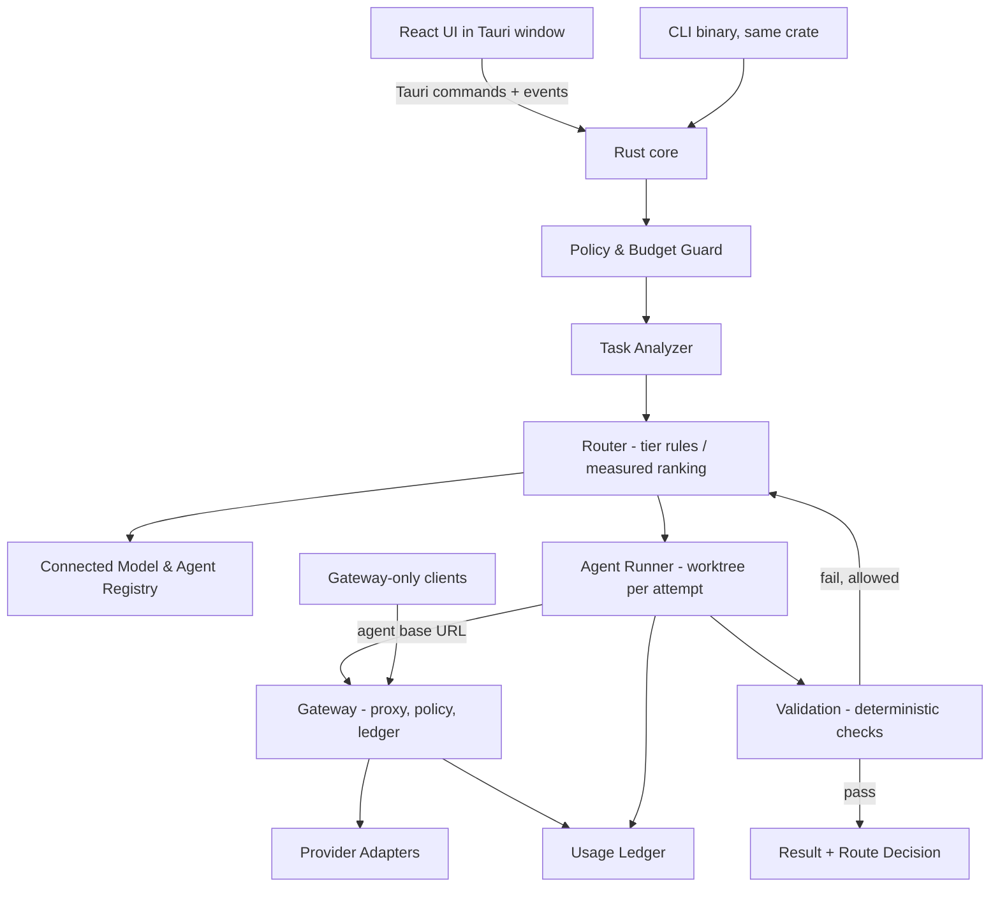

# SmartTaskRouter — UI/UX & Functional Implementation Plan

> Version: 1.2 addendum | Date: 2026-11-11 | Status: design plus early implementation; shared memory is proposed, not built
>
> Reference direction: 9Router-style provider/quota/endpoint management, extended with task-level routing that is checked by deterministic verification.

> **CURRENT DELIVERY PRIORITIES (2026-11-11):** [ROADMAP.md](ROADMAP.md) is authoritative; [IMPLEMENTATION-STATUS.md](IMPLEMENTATION-STATUS.md) is authoritative for implemented code. The gateway, headless `gateway serve` CLI and gateway-first desktop screens have been built; older Phase 0–4 ordering, six-destination/task-first descriptions and mock-up colors below are retained as historical design. [Review response](reviews/2026-11-11-review-response.md) addresses the Claude findings. No Smart Memory, Auto Router or cost savings are claimed as implemented.

## Update — AI Cost Optimizer + Universal Shared Memory (2026-11-11)

**Product north star:** SmartTaskRouter serves everyday AI users **and** developers. Its primary value is automatically choosing a capable model from connected providers to reduce **total cost per quality-preserving answer or completed task**, not merely providing gateway routing or a coding agent runner. For normal chat, user sends a message in Auto mode without selecting a model or answering a complexity questionnaire.

**Universal Shared Memory** is a new core design: preserve a portable raw conversation record; use compact summaries, recent turns, retrieval of relevant facts, explicit work checkpoints and model-specific context packages. Model Affinity compares keeping the current model (including cache advantage) to switching (rehydration/compaction/validation costs), and only switches when it is beneficial and policy-allowed. Never assume cross-provider reuse of hidden reasoning, KV cache, tool state or provider-specific session artifacts.

**Open-source references:** Mem0 (fact extraction/retrieval), OpenCode (compaction/continuity), Letta (persistent shared memory), LangGraph (checkpoints/store), Aider (token-budgeted repo context), Graphiti (temporal facts, later). External benchmark claims are not SmartTaskRouter measurements.

**Source of truth:** [Universal Shared Memory technical proposal](UNIVERSAL_SHARED_MEMORY.md) covers architecture, scopes, schema, cache-aware handoff, privacy, UI and A/B/C/D/E benchmarks. Existing Git-worktree verification remains mandatory for automatic coding cascades; consumer chat has its own quality and consent rules.

**Roadmap synchronization:** ADR-016 overrides the earlier benchmark-first delivery order in ADR-013. Build the gateway and ledger first, then portable conversation history/context handoff and model affinity, followed by Auto Chat and long-term memory; benchmark both switching/continuity and coding cascade before claiming savings. Current screens remain task-list-first until the new consumer chat flow is designed and reviewed.

## Update — CLI / IDE, npm and provider tiers (2026-11-11)

The gateway-first release will support terminal CLI and IDE integrations through individually verified compatible endpoints, along with an optional **headless Rust CLI** distributed by a thin npm/npx launcher (package availability and release not yet verified). Providers are shown by **Free, Subscription, API Paid, Local, Unknown** entitlements, with billing tier **per account-model**, not only per provider. OAuth/API key/local endpoint are authentication methods, not billing groups. Subscription-backed integrations must use provider-permitted official interfaces. **Detailed contracts, UX, data model and release gates:** [CLI_IDE_NPM_PROVIDER_TIERS.md](CLI_IDE_NPM_PROVIDER_TIERS.md).

## Update — Authorized account/API rotation (2026-11-11)

Add Account Pools with Fill First, Round Robin, Sticky Round Robin, Weighted and Cost-Aware strategies; verified account-model entitlements; quota/reset-aware cooldown, per-client allowlists, circuit breakers, atomic concurrency reservations and safe pre-stream failover. Persist conversation affinity to avoid cache loss and unintentional context changes. No credential/IP rotation to evade provider restrictions or bypass shared quotas. Full authoritative proposal: [ACCOUNT_API_ROTATION.md](ACCOUNT_API_ROTATION.md). Gateway-first G1–G2 includes basic selection; cost-aware rotation builds on Universal Shared Memory and measurement. This is not implemented yet.

## Update — OmniRoute evaluated and feature scope locked (2026-11-11)

[OMNIROUTE_FEATURE_RESEARCH.md](OMNIROUTE_FEATURE_RESEARCH.md) defines the feature decisions and evidence boundaries: **P0** dynamic connected-model candidate factory, Free Tier Intelligence with shared quota groups, strict eligibility and `auto` aliases, account-health cooldown/circuit breaker, safe pre-stream failover, and opt-in/shadow-tested deterministic compression; **P1** memory/cache-aware model affinity, calibrated routing scores and general-user Auto Chat; **P2** optional semantic caching and advanced compaction only after independent quality tests. Default UX remains automatic model selection without extra questions. Reject default multi-model fusion, chaos routing, session spoofing and unverifiable savings numbers. The existing gateway-first ADR-016 remains current; these modules extend rather than replace the codebase.

## Changes in 1.1

- **Product shape decided:** the product is an orchestrator first. Routing happens at task and stage boundaries, and the gateway is the transport and enforcement layer. Within one agent session the model is never switched silently.
- **Routing brain specified:** MVP routing uses a rule-based tier table. Learned cost-per-success ranking comes later and only once enough measured data exists.
- **Free-first only runs with deterministic checks.** A cascade from a cheaper tier needs a typecheck, test, build or schema check. An LLM reviewer can advise but cannot pass a stage on its own. Every attempt runs in an isolated worktree or checkpoint.
- **Cost model corrected:** adds a `Subscription` billing type and records where each quota figure comes from. Records whether a provider's terms allow training on submitted data and treats that as a privacy constraint.
- **Benchmark first:** a new Phase 0 tests the core idea (cascade vs. always using one model) before the UI is built.
- **Scope cut:** navigation goes from 12 items to 6 destinations. The Skills Hub moves to Phase 4.
- **Stack and design aligned with DownFetch:** one Tauri 2 app with a Rust core (gateway, router, agent runner) and a React 19 + Vite interface styled with semantic CSS tokens after Apple's HIG. Design reviews use the `apple-design` skill. This replaces the earlier Node/Fastify + Tailwind/shadcn proposal and the 9Router-style web-dashboard look; orange stays as the accent color (§1, §4).
- **Target users and competitive landscape added;** model tiers are now defined; broken mockup references are fixed.
- **Screen design agreed** ([docs/design/SCREENS.md](design/SCREENS.md)). Navigation is list-first with six destinations and no Overview. Workspaces get their own settings. A passing result is handed off as a kept Git branch. Approvals are durable and cover exactly one attempt. MVP writes only to Git workspaces, and crash recovery moves into Phase 1.

## 0. Product scope and principles

**Goal:** optimize quality-adjusted total cost per accepted AI answer or completed task across connected and authorized providers, without requiring the user to choose a model every turn. Initial measurable release targets developer/API agent workflows; consumer Auto Chat remains in the product vision. Developer task-stage routing is one mode, not the entire product. Cheaper models are tried first only where the result can be verified automatically. Escalation is explained and, when paid, approved by the user.

**Initial developer MVP users:** individual developers who already use two or more coding agents or providers. They typically mix subscriptions, free tiers, pay-per-token APIs and local models, and want to spend less without losing quality or control. Small teams and hosted multi-user mode are out of scope until after Phase 4.

**Principles:** connected-model-first; free-first only when the output can be verified; user confirmation on paid escalation; transparent routing; minimum necessary context; security-first handling of third-party content; usage-based optimization; reversible settings.

**Non-goals for initial developer MVP:** full IDE replacement; arbitrary website agent browsing; GitHub skill marketplace; learned/ML router; cloud orchestration at scale; guaranteed free execution or guaranteed savings. Everyday Auto Chat and shared conversation continuity are a planned expansion, not a claim of current implementation.

### 0.1 Gateway implemented first; orchestrator and app-owned Auto Chat follow (ADR-016, ROADMAP)

The plan supports two modes with distinct semantics:

| Mode | Who sends requests | Routing unit | Model switching |
| --- | --- | --- | --- |
| **Task orchestration** (primary) | SmartTaskRouter launches an agent CLI for each stage | Task / stage | Chosen once per stage attempt; a new attempt may use a higher tier |
| **Gateway-only** | Any OpenAI/Anthropic-compatible client | Single request via a policy-routed model alias | Model is pinned per conversation; fallback happens only on hard errors before any output is streamed, is logged, and goes to a model with the same capabilities |

**Why not route each request inside an agent loop:** switching models mid-session invalidates prompt caches, can break tool-call formats and conversation state, and makes outcomes hard to reproduce. The gateway sees single requests without task context, so it cannot judge task difficulty anyway.

In orchestration mode the agent CLI's base URL points at the local gateway where the agent supports it. That lets the gateway enforce budgets and record usage for every request. Agents that use their own subscription login run with their native authentication (see §3.7).

### 0.2 Competitive landscape

| Product | What it does (summary) | Gap SmartTaskRouter targets |
| --- | --- | --- |
| 9Router | Provider connections, quota tracking, model combos with fallback, compatible endpoints | No task understanding or verification-driven escalation |
| claude-code-router | Rule-based routing of Claude Code requests to other providers (e.g. background, long-context, reasoning) | Per-request rules inside one agent, no outcome validation or cost-per-success |
| LiteLLM proxy | Gateway with many providers, budgets, fallbacks, spend tracking | Infrastructure layer only; no task-level planning |
| OpenRouter Auto | Hosted automatic model selection | Hosted only, limited to OpenRouter's catalog, no local models or user policy |
| RouteLLM | Research framework for learned strong/weak routing | A library, not a product; needs training data |

**Differentiation:** task-level routing across agents and providers, cascading driven by deterministic checks, cost measured per *successful* task, and local-first privacy.

> These summaries were written from memory at planning time. Check each product's current features before using this table in external positioning.

## 1. UI design system

The interface follows the same approach as DownFetch (`F:\2026\DownFetch\apps\desktop\src\styles.css`): a native-looking desktop app styled after Apple's Human Interface Guidelines, rather than a web-dashboard template.

- **Platform:** Tauri 2 window with DownFetch's traffic-light window controls on every platform (a deliberate departure on Windows; see SCREENS.md D12); Windows first, macOS next. Desktop-first at 1440×900, usable down to 1024px.
- **Styling:** plain CSS with semantic tokens on `:root` (`--window`, `--sidebar`, `--surface`, `--control`, `--field`, `--label`, `--secondary`, `--separator`, `--hover`, `--selection`, `--accent`, `--accent-text`, `--green`, `--orange`, `--red`, `--focus`…). No Tailwind or shadcn.
- **Appearance:** follows the system light/dark setting through `prefers-color-scheme`, with `prefers-contrast: more` overrides. There is no in-app theme switch, matching DownFetch.
- **Accent:** SmartTaskRouter keeps orange as its brand color, tuned for contrast like DownFetch's tokens. Proposed values: fill `#C2410C` (white text on it about 5:1) and text `#B93A0A` in light mode; `--accent-text` `#FB923C` in dark mode. Verify every pair with a contrast checker before use.
- **Type:** system font stack (`-apple-system`, `SF Pro Text`, `Segoe UI Variable Text`, `Segoe UI`, `system-ui`) and a system monospace stack for model IDs, tokens and logs. Both cover Vietnamese.
- **Icons:** `lucide-react`, always paired with a text label or an accessible name.
- **Shell:** sidebar, toolbar with gateway status and workspace, command palette `Ctrl/Cmd+K`, sheets for confirmations (approval, paid escalation), tray icon so the gateway keeps running when the window is closed.
- **System-wide states:** loading; empty; offline; auth error; quota exhausted; forbidden by policy; degraded; stale metadata; failure; success.
- **Accessibility:** visible focus ring (`--focus`), full keyboard workflow, AA contrast documented next to each token, reduced-motion support.
- **Language:** `t()` with English text as the key, as in DownFetch's `src/lib/i18n.ts`; English and Vietnamese at first, more locales later.
- **Design review:** every screen is reviewed with the `apple-design` skill (`dickwu/apple-design-skill`, pinned in `skills-lock.json` under `.agents/skills/`, as in DownFetch).

### 1.1 Badges

Badges describe facts, not quality.

| Group | Values | Notes |
| --- | --- | --- |
| Billing | `Free`, `Local`, `Subscription`, `Paid`, `Unknown` | `Unknown` is never treated as `Free` |
| Data use | `No training`, `May train`, `Terms unknown` | Comes from provider terms recorded with a source and check date |
| Provenance | Source + time per fact, e.g. `Provider API · checked 14:32`, `Ledger estimate`, `Unknown`, `Stale · Nov 3` | Attached to each value, not to a whole row; no generic `Live` badge (SCREENS.md §3) |
| Tier | `T0`–`T4` | See §2.4.1 |

### 1.2 Navigation

The navigation is list-first like DownFetch: the task list is home, and there is no Overview dashboard. The six destinations are Tasks, Connections, Policies, Usage, Endpoints and Settings. A Skills destination is added in Phase 4. Full screen design: [docs/design/SCREENS.md](design/SCREENS.md).

| Sidebar group | Items |
| --- | --- |
| Tasks | All Tasks, Running, Needs Approval, Completed, Failed, Stopped (filters with counts; "Needs Attention" pinned on top of the list) |
| Workspaces | Each registered workspace (scopes the list) and Add Workspace… |
| Manage | Connections, Policies, Usage, Endpoints |
| App | Settings |

| Destination | Contains |
| --- | --- |
| Tasks | Task list and task detail (New Task → Plan → Run → Result); Workspace Settings |
| Connections | Tabs: Providers, Models, Agents (one agent in Phase 1) |
| Policies | Strategies/combos, tier table, rules hierarchy, budgets, simulator |
| Usage | Ledger analytics, budgets, cost per success |
| Endpoints | Gateway addresses, client tokens, client setup |
| Settings | App, storage, retention, diagnostics |

### 1.3 Design mockups

The agreed screen design, with ASCII wireframes for every screen and sheet, is [docs/design/SCREENS.md](design/SCREENS.md). Where it is more detailed than §2 below, SCREENS.md takes precedence.

Older editable SVG wireframes are also in `docs/design/`:

- `smart-routing.svg`: task entry and route recommendation.
- `providers.svg`: provider connections and catalog state.
- `model-combos.svg`: strategy pipeline, budget and fallback configuration.

The wireframes predate v1.1. They still show the 12-item navigation, the duplicated stage panels and the old web-dashboard style. They need redrawing to match §1, §1.2 and §2.2, preferably as working screens in the app with mock data rather than as static SVG. All values in them are illustrative, not real provider data.

## 2. Screen-by-screen UX specification

### 2.1 Task list (home)

There is no Overview dashboard. The home screen is the task list, filtered from the sidebar. Waiting approvals, interrupted tasks and plans that need revalidation are pinned under **Needs Attention**. Each row shows the attempt sequence (tier, outcome, arrow to the next attempt) and cost so far. The toolbar subtitle shows running and waiting counts plus a qualified budget summary. Gateway status sits in the sidebar footer and tray. First launch shows an empty list with the Setup Assistant sheet. Warnings appear as banners under the toolbar.

**Acceptance:** counts reconcile with task states; a failed load is never shown as an empty list; unknown cost is labeled, never shown as $0.

### 2.2 Task detail (primary screen)

The task detail is the product's differentiator and must show *why* each model was chosen. It has four phases on one screen: New Task → Plan → Run → Result (SCREENS.md §5.2). The sections below describe its content.

**Input panel:** multiline task and strategy `Free First | Balanced | Quality` or a custom policy. Workspace, privacy class, checks and permissions are inherited from the workspace (§2.8). A task can tighten them but cannot loosen them.

**Analysis summary (one line, expandable):** category, complexity, required capabilities (tools, context size, vision), risk level, available deterministic checks detected in the workspace (e.g. `tsc`, `npm test`).

**Route plan: a single list with one expandable row per stage.** No separate "breakdown" panel. Each row always shows three lines: who runs it, the check, and the cost. The other fields below sit inside the expanded row.

| Field | Content |
| --- | --- |
| Stage | Name and goal (e.g. "Implement fix + tests") |
| Agent | Agent CLI to run (or "direct model call") |
| Model | Provider + exact model ID, billing/data/tier badges |
| Why | Top 2 reasons (e.g. "lowest tier meeting T2 minimum", "supports tool calls") |
| Excluded | Count with an expandable list: model and reason (no tool calls, context too small, may train on data, quota exhausted…) |
| Estimate | Token range and cost range, or the % of subscription quota window used; `Unknown` if a range cannot be computed |
| Check | Deterministic check that gates the stage, or "manual review" |
| On fail | Next tier/model, and whether approval is needed |

Each row has controls to change the model (chosen from eligible candidates only), edit the stage, or disable a stage.

**Footer:** total estimate range, approval gates that will trigger, dry-run, **Run**.

**Live run (same page):** stage timeline, attempt number, streamed redacted output, check results, escalation events with reasons, approval prompts, cancel.

**Result:** the diff of the passing attempt, the checks that ran, the base revision, and estimate vs. actual cost including failed attempts. The handoff in MVP is **Keep as Branch**: commit the passing result to a durable branch `str/<slug>-<id>` from the base revision, without switching the user's branch, and keep it out of automatic cleanup. The alternatives are **Export Patch…** and **Discard Result…**. **Apply to Workspace** with drift detection comes later. The result is labeled **Checks Passed**, never "correct".

**History:** there is no separate tab. Completed, Failed and Stopped tasks stay in the list, with search. The detail shows the request, classifier output, route decision with exclusions, attempts, check results and estimate vs. actual. Actions: duplicate into a new reviewed plan, export redacted trace; compare two runs later.

**Approvals:** a pending approval is durable and covers exactly one attempt and its spending cap. It is invalidated if the candidate, policy or budget changes, and it is recovered after a restart. It reaches the user through a panel on the task, a banner elsewhere, the tray, and a notification that omits task names and paths. Nothing is approved automatically (SCREENS.md §2.5, §6.3).

**Error states:** no provider, no agent, no eligible model for a stage, insufficient quota/budget, estimate unavailable, no deterministic check (so the cascade is disabled for that stage), workspace not isolatable, timeout, policy denial, interrupted run.

**Acceptance:** the route uses connected eligible models only; every chosen and excluded model has a reason; free-first never picks a model that fails a hard requirement; billing gates are honored; failed and canceled attempts appear in history and usage.

### 2.3 Connections

**Providers tab:** provider, status, auth type, account label, model count, quota (value + source), health, latency, last check. Operations: connect/reconnect, test, rotate credentials, disable/remove, sync catalog, inspect errors. Types: OpenRouter, Anthropic, OpenAI, Google Gemini, Ollama/local, user-defined OpenAI-compatible.

**Quota provenance** is always shown:

| Source | Meaning |
| --- | --- |
| `provider_api` | Returned by an official quota/credit endpoint |
| `response_headers` | Derived from rate-limit headers on real responses |
| `ledger_estimate` | Calculated from SmartTaskRouter's own usage ledger against a user-entered limit |
| `unknown` | No reliable source; routing treats remaining quota as unknown |

Most providers do not expose remaining quota through an API, so `ledger_estimate` and `unknown` will be common and the UI should design for them.

**Data-use terms** per provider/plan: whether the provider may train on submitted data, the source link and the date checked. This is set by the user or pre-filled from a curated default, and is marked stale after a configurable period.

**Models tab:** filters (provider, billing, tier, data use, price, tool calling, structured output, reasoning, context length, vision, streaming, availability); details (exact ID, capability provenance, price/quota freshness, measured reliability/latency once available); actions (favorite, disable, test with consent, assign tier override, compare).

**Agents tab (Phase 2):** registered agent CLIs (Claude Code, Codex, OpenCode, others explicitly supported). Shows version, auth mode (gateway-routed or native subscription), whether the agent accepts a custom base URL, capabilities, and a connectivity test.

**Acceptance:** tests never expose secrets; a provider outage is distinguishable from invalid credentials; stale pricing is labeled; a model with unknown capabilities is not assumed to support tool calls.

### 2.4 Policies

Merges the former Model Combos and Routing Rules pages so that budgets, fallbacks and allowlists are edited in one place.

**Strategies (combos):** Free First Coding, Balanced Development, Deep Architecture; duplicate and customize. Each strategy sets a starting tier per task category, maximum tier, attempts per tier, latency target, token budget, paid-approval threshold, allowed providers and privacy class.

**Pipeline shown per strategy:** Classify → Filter → Select lowest eligible tier → Execute in isolation → Check → Accept, or Escalate one tier.

#### 2.4.1 Tier table

| Tier | Meaning | Typical billing |
| --- | --- | --- |
| T0 | Local model on user hardware | Local |
| T1 | Small/fast cloud models, often free tier | Free / Paid (low) |
| T2 | Capable general/coding models at low cost | Paid / Subscription |
| T3 | Strong coding/reasoning models | Paid / Subscription |
| T4 | Frontier models for hardest tasks | Paid / Subscription |

Default tier assignments ship as a curated, versioned table. Users can override them per model. Once Phase 3 benchmarks exist, measured results may suggest changes, but a change is never applied without the user's approval.

**Minimum tier rules:** a versioned table of task category × complexity → minimum tier (e.g. "docs edit, low" → T0; "multi-file refactor, high" → T3). The simulator shows which rule decided each stage.

**Rules hierarchy:** global defaults → workspace overrides → task-specific exceptions. The most restrictive security and privacy constraint always applies.

**Budgets:** per task, daily, monthly, per workspace and per client token. Concurrent tasks share budgets atomically.

**Simulator:** dry-run against synthetic or past tasks; conflict diagnostics; shows the deciding rule.

**Acceptance:** invalid or cyclic fallback routes rejected; policy changes versioned; deny/approval conditions cannot be bypassed by subagents, retries or gateway-only clients.

### 2.5 Usage

**KPIs:** task success rate, cost per successful task, total spend (actual/estimated/unknown kept separate), subscription window usage, free/local share, p50/p95 latency, attempts and escalations per task, cache effectiveness.

**Views:** by workspace, day, provider, model, agent, strategy and task category; budget alerts; anomaly detection (Phase 3).

**Cost comparison:** only against a reproducible baseline (see Phase 0), never claimed savings. Local inference cost is shown separately, using user-entered hardware/electricity figures if provided.

**Acceptance:** totals reconcile with the usage ledger and provider responses; estimated and unknown values are labeled separately.

### 2.6 Endpoints

**Modes:** gateway pass-through, policy-routed model alias, task-orchestration API; semantics kept distinct and documented.

**Clients:** configuration snippets for OpenAI/Anthropic SDKs and supported agent CLIs; health, version, local address.

**Credentials:** scoped client tokens, rotation/revocation, per-client budgets; bind to `127.0.0.1` by default.

**Acceptance:** streaming, abort, usage reporting, retries and error mapping match the advertised endpoint contracts, verified by contract tests.

### 2.7 Settings

Language, updates, startup and tray behavior, data directory, telemetry opt-in, catalog/terms sync cadence, local runtime, data retention, log redaction, backup/export, diagnostics, API binding. Appearance follows the system (§1).

### 2.8 Workspaces

A sidebar group lists registered workspaces, plus **Add Workspace…**. Selecting a workspace scopes the task list. **Workspace Settings** owns the folder path, Git and isolation readiness, privacy class and permitted context, approved checks, and the effective policy, with a link to workspace overrides in Policies. Changes apply to new plans; existing tasks keep their snapshots. In MVP, only Git workspaces that can be isolated accept write-capable tasks; other folders get read-only planning.

### 2.9 Skills & Prompts (Phase 4)

Curated GitHub skill discovery, preview, pinned installs and permission review. Until Phase 4 the router only reads skills already installed in the agent's own configuration and shows them as context. It never downloads or installs anything.

Requirements kept from v1.0: provenance (repo, commit, license) shown; installs require confirmation, pin a hash, and support rollback/uninstall; scripts are never auto-executed; repository content is treated as untrusted data; prompts load progressively to avoid unused tokens.

## 3. Core routing system

### 3.1 Where decisions happen

- **Stage boundary:** the router picks agent + model for each stage attempt.
- **Attempt boundary:** after a failed check, the router may pick a higher tier for the next attempt.
- **Never mid-session:** an agent session keeps its model until it finishes or is canceled.

### 3.2 Functional pipeline

1. Receive task + workspace + strategy + hard policy.
2. Normalize the task; apply explicit constraints (named model, privacy class, budget).
3. Classify category and complexity with heuristics or a local classifier. Use a small connected model only if needed and allowed by budget.
4. Detect available deterministic checks in the workspace.
5. Build the eligible candidate set from the live registry (§3.3).
6. Select per stage (§3.4) and build the plan with reasons and exclusions.
7. Obtain approval where policy requires it.
8. Execute each attempt in isolation (§3.5) and stream events.
9. Run checks; accept, or escalate within policy.
10. Persist the route decision, attempts, check results and the usage ledger.

### 3.3 Candidate filtering (hard constraints)

A model is excluded, and the reason recorded, if any of these hold:

- It is disabled, disconnected or unhealthy.
- Its quota is known to be exhausted, or its remaining quota is `unknown` and policy requires known quota.
- It lacks a required capability (tool calls, structured output, vision, context length). Unknown capability counts as missing.
- It is not in the provider/model allowlist.
- Its data-use terms conflict with the workspace privacy class (e.g. `May train` or `Terms unknown` for a sensitive workspace).
- Its billing is `Unknown` or `Paid` and the remaining budget or approval policy does not allow it.

`Free` requires currently verified pricing or entitlement. `Local` has an operational cost that is tracked separately.

### 3.4 Selection

**v1 (MVP), rule-based:**

1. Determine the minimum tier from the tier rules table (§2.4.1).
2. Choose the starting tier. Free First and Balanced start at the minimum tier for stages with a deterministic check. A stage without a deterministic check gets **no automatic cheap-first cascade**: the user may review a direct run at the strategy's normal tier, and accepting its result is recorded as **Manually Accepted**, never as checks passed. Quality starts at the strategy's preferred tier.
3. Within the tier, prefer billing in this order: Local → Free → Subscription with quota headroom → Paid. Then prefer better health, lower latency, then lower price.

v1 picks the *lowest eligible tier under the user's policy*. It does not measure total cost, so the UI and docs must not call its choice "the cheapest".

**v2 (Phase 3), measured:** rank by expected cost per successful result:

`expected_total = Σ_attempts P(reach attempt) × (inference + context + tool_overhead + validation) + local_operating_cost`

Success probabilities come from Phase 0/3 benchmarks and the ledger, per model and task category. Use smoothing and a minimum sample size; below that size, v1 rules decide. Measured results can override the rules only within the hard constraints of §3.3.

### 3.5 Verification, isolation and escalation

- **Deterministic checks gate the cascade.** A stage may cascade from a cheaper tier only if it has a deterministic check (compile/typecheck, lint, tests, build, schema/contract). Checks are detected automatically and approved per workspace, or declared by the user.
- **LLM review is advisory.** It can flag problems or trigger escalation, but cannot pass a stage on its own. A reviewer model must be at least the tier of the model it reviews.
- **Isolation per attempt:** each attempt runs in a separate git worktree. A failed attempt's changes are discarded; only a passing attempt's diff is offered to the user. In MVP, workspaces that cannot be isolated (non-Git) are limited to read-only planning; snapshot isolation for non-Git folders is a later option.
- **Bounded attempts:** maximum attempts per tier and per task; the same model is never retried with identical input. The next attempt receives a bounded summary of the previous failure.
- **Escalation:** one tier at a time unless the stage's risk level allows skipping tiers. Paid escalation above the threshold waits for approval. The reason for every model switch is stored.
- **Direct routing:** high-risk or hard-to-verify stages go straight to an appropriately capable tier rather than cascading.

### 3.6 Context optimization

Repository retrieval scoped to relevant paths, hash-based caching, compact task summary, no duplicated agent transcripts, progressive loading of skill prompts, per-stage token caps, privacy-aware redaction.

### 3.7 Cost and quota model

- **Paid:** cost from provider-reported usage × verified price; estimates labeled until actuals arrive.
- **Subscription:** measured as consumption of the plan's usage window, not money. Subscription-backed agents (e.g. a coding CLI logged in with a personal plan) run with their native authentication. SmartTaskRouter does not proxy, extract or share subscription credentials, and routes to such agents only in ways the provider's terms permit.
- **Free:** may have rate limits and data-use terms. Both are recorded and enforced (§3.3).
- **Local:** no API cost; optional user-entered operating cost; resource usage (time, memory) recorded.
- **Unknown:** never treated as free; blocked or gated by policy.

## 4. Proposed technical architecture



### Stack (decided: same as DownFetch)

The stack reuses what DownFetch (`F:\2026\DownFetch`) already ships, so its tooling, patterns and lessons carry over.

| Layer | Choice | DownFetch precedent |
| --- | --- | --- |
| Monorepo | pnpm 9 workspace (`apps/*`), root scripts `dev`, `build`, `typecheck` | `package.json`, `pnpm-workspace.yaml` |
| App shell | Tauri 2, one Rust crate with modules (no sidecar) | ADR-007 |
| Frontend | React 19, Vite 6, TypeScript 5, `lucide-react`, plain CSS tokens | `apps/desktop` |
| UI ↔ core | Tauri commands and events through one typed `lib/native.ts` wrapper | `src/lib/native.ts` |
| Async runtime / HTTP client | tokio, `reqwest` with rustls and streaming | `Cargo.toml` |
| Gateway server | `axum` (on hyper/tokio) bound to `127.0.0.1` | New for this project |
| Persistence | SQLite through `rusqlite` (bundled), migrations from day one | `Cargo.toml` |
| Secrets | `keyring` (OS credential store) + `aes-gcm` for sealed fields | `vault.rs`, ADR-010 |
| Agent runner | `tokio::process` supervisor, a git worktree per attempt, process-tree termination, redaction | `jobs.rs`, `no_window.rs` |
| Desktop integration | Tauri plugins: tray icon, single-instance, autostart, notification, dialog, opener, signed updater | `tray.rs`, `updater.rs`, ADR-014 |
| i18n | `t()` with English keys, lazy-loaded locales (`vi` first) | `src/lib/i18n.ts`, `src/locales/` |
| Design skill | `apple-design` pinned in `skills-lock.json`, installed under `.agents/skills/` | `skills-lock.json` |
| Dev preview | `.claude/launch.json` entry running the UI on a fixed port (`--strictPort`), plus a mock data mode for screens without the native core | `desktop-ui`, `desktop-mock` |
| Docs | `docs/ARCHITECTURE.md`, `docs/DECISIONS.md` (ADRs), `docs/IMPLEMENTATION-STATUS.md`, `docs/ROADMAP.md`, `docs/SECURITY.md` | `docs/` |

**Provider adapters:** native OpenAI-compatible and Anthropic Messages formats first; OpenRouter, Gemini and Ollama through their compatible endpoints where these are complete enough, native adapters otherwise. Capability metadata is kept explicitly per provider. Rust has fewer ready-made multi-provider libraries than Node or Python, so adapters are written in-house against recorded fixtures, as DownFetch did with its own HTTP engine (ADR-008).

**Where this project differs from DownFetch:** DownFetch talks to its browser extension through Native Messaging and avoids a localhost API (ADR-003). SmartTaskRouter needs a localhost HTTP gateway, because SDKs and agent CLIs can only reach a model through a base URL. The gateway therefore binds to `127.0.0.1` only, requires a scoped client token on every request, and refuses non-loopback binding unless the user turns it on explicitly.

### Key technical risk: format translation

If an agent speaks the Anthropic format and the router picks an OpenAI-format model (or the reverse), the gateway must translate messages, tool calls, streaming events, usage and errors. This is easy to get subtly wrong. MVP supports only these routes:

- same-format routes, plus
- translated routes that pass the contract test suite for that specific agent.

Any other combination is marked ineligible with the reason "format not verified".

### Rust modules (in `src-tauri/src/`)

`connections.rs`, `catalog.rs`, `quota.rs`, `terms.rs`, `analyzer.rs`, `router.rs`, `policy.rs`, `agents.rs`, `isolation.rs`, `validation.rs`, `ledger.rs`, `gateway/` (server, adapters, format translation), `vault.rs`, `bench.rs`, `settings.rs`, `tray.rs`, `updater.rs`; `skills.rs` in Phase 4.

## 5. Data model (logical)

| Entity | Primary fields |
| --- | --- |
| providers | id, type, endpoint, enabled, health, credential_ref, data_use_terms, terms_source, terms_checked_at |
| models | id, provider_id, model_id, capabilities, capability_source, context, price, billing_type, tier, tier_override, status, observed_at |
| quotas | provider_id, model_id, kind (credits/requests/tokens/window), limit, remaining, reset_at, source, observed_at |
| agent_connections | id, type, executable, version, auth_mode, supports_base_url, capabilities, enabled |
| workspaces | id, name, path, privacy_class, isolation_mode, detected_checks, policy_id |
| strategies | id, name, tier_start_rules, max_tier, attempts_per_tier, approval_threshold, version |
| tier_rules | id, category, complexity, min_tier, version |
| routing_policies | id, scope, overrides, budget, allowlists, version |
| tasks | id, workspace_id, prompt_ref, status, policy_snapshot, catalog_snapshot, created_at |
| task_stages | id, task_id, name, check_spec, status |
| attempts | id, stage_id, agent_id, model_id, tier, isolation_ref, check_results, status, escalation_reason |
| route_decisions | id, stage_id, eligible, excluded_with_reasons, deciding_rule, chosen |
| usage_events | id, attempt_id, provider, model, input/output/cache_tokens, cost, cost_status (actual/estimated/unknown), quota_window_usage, status |
| approvals | id, task_id, action, estimated_cost, outcome, timestamp |
| bench_runs | id, suite_version, case_id, model_id, agent_id, passed, tokens, cost, latency, run_at |
| audit_events | id, actor, action, entity, metadata_redacted, timestamp |
| skills, skill_installs | Phase 4: repo_url, ref, path, hash, license, trust, permissions / pinned_hash, approved_permissions |

Immutable per-task policy and catalog snapshots keep history reproducible. Keys never appear in these tables in plaintext.

## 6. API contracts (draft)

The app's own UI calls these operations as Tauri commands (e.g. `routes_analyze`) and receives task events as Tauri events. Over HTTP, the gateway exposes the compatible `/v1/*` endpoints. The `/api/*` paths are exposed only for external clients and the CLI, behind a client token. Each operation has one typed definition shared by both transports.

| Method | Path | Purpose |
| --- | --- | --- |
| GET | /api/health | Service readiness and version |
| GET/POST | /api/providers | List/create connections |
| POST | /api/providers/:id/test | Test provider |
| POST | /api/providers/:id/sync | Refresh catalog, quota and terms |
| GET | /api/models | Filter models by capability, billing, tier, terms |
| GET | /api/agents | Registered agent CLIs (Phase 2 for more than one) |
| GET/POST | /api/strategies | Configure strategies |
| GET/POST | /api/tiers | Tier assignments and minimum tier rules |
| GET/POST | /api/policies | Rules hierarchy and budgets |
| POST | /api/routes/analyze | Classify task, detect checks, propose plan |
| POST | /api/routes/simulate | Dry-run selection with reasons, no execution |
| POST | /api/tasks | Approve and start a planned task (idempotency key required) |
| GET | /api/tasks/:id | Task state, attempts and output |
| GET | /api/tasks/:id/events | Stream stage, attempt, check and usage events |
| POST | /api/tasks/:id/cancel | Request cancellation |
| POST | /api/tasks/:id/approvals/:approvalId | Approve or deny a gated action |
| GET | /api/usage | Usage, budgets, cost per success |
| POST | /api/bench/run | Run benchmark suite against selected models/agents |
| — | /v1/chat/completions, /v1/messages, /v1/models | Compatible gateway endpoints |

Version the contracts; validate all request schemas; keep cancellation safe; support request-scoped budgets and rate limits. Compatible endpoints are tested per advertised client.

## 7. Security and privacy

- API keys encrypted at rest using OS-protected secrets where available; privileged APIs listen on loopback only by default.
- Explicit user permission for workspace files, shell, network and destructive actions; agents never receive more permission than granted.
- Each attempt is isolated; failed attempts cannot leave changes in the user's working tree.
- Data-use terms are enforced as a hard constraint for privacy classes; unknown terms count as unsafe for sensitive workspaces.
- Third-party content (repository files, skills, web pages) is data, not instructions; tool boundaries are enforced.
- Model inference is separated from tool execution; secrets, tokens and sensitive paths are redacted in traces.
- Paid usage obeys per-task, daily and workspace budgets; unknown price cannot be treated as free.
- No credential sharing, no proxying of subscription credentials, no attempts to bypass provider limits or plan terms.
- Signed binaries, secure update channel and dependency checks before public release.

## 8. QA & acceptance scenarios

1. First run without a provider shows a guided empty state, not a fabricated route.
2. Free-first picks an eligible connected free/local model for a simple task with a deterministic check; never a model failing a hard requirement.
3. A stage without a deterministic check does not start below the strategy's default tier.
4. Tool-calling, context-length or format-translation requirements exclude incompatible models, each with a visible reason.
5. A sensitive workspace excludes providers marked `May train` or `Terms unknown`.
6. Failed check: the attempt's changes are discarded, the next attempt escalates one tier, and the reason is recorded.
7. Paid escalation waits for approval when policy requires it; denial stops the task cleanly with partial results.
8. Quota exhaustion triggers only permitted fallback, and the source of the quota figure is shown.
9. Subscription-backed agent usage is shown as quota-window consumption, not money.
10. Gateway-only mode never switches models mid-conversation except on a pre-stream hard error, which is logged.
11. Per-task ledger includes failed attempts and partial billable calls.
12. Concurrent tasks never exceed a shared budget.
13. Agent cancellation terminates the process tree and records the incomplete attempt.
14. Gateway streaming, errors and usage pass contract tests for each supported client and each translated route.
15. Redaction tests confirm no credentials or sensitive prompt data appear in logs or traces.
16. Crash recovery preserves task history, approvals, worktrees and accurate usage.
17. Analytics compare only against a reproducible baseline; no fictional savings.

## 9. Roadmap and deliverables

### Benchmark track: Validate the idea after gateway foundation (ADR-016)

- After the gateway foundation is available, build a benchmark suite of 20–40 reproducible coding tasks on small fixture repos. Each task has a deterministic pass check (typecheck/tests/build), across categories such as bug fix, small feature, refactor, test writing and docs.
- Write the harness as a CLI binary in the Rust crate (`src-tauri/src/bin/bench.rs`). It runs each task with an agent CLI and a chosen model in a worktree, and records pass/fail, tokens, cost/quota and latency. The worktree, process-supervision and ledger code it needs is the same code the app uses later.
- Compare three baselines: always-T4, always-T2, and a T0/T1 → T2 → T3 cascade driven by checks.
- Seed the default tier table and minimum tier rules from the results.

**Exit:** a written report of pass rate and cost per success for each baseline. If the cascade does not reach comparable pass rates at lower cost per success, revisit the product's core idea before Phase 1.

### Historical Phase 1: gateway and task-routing proposal (see ROADMAP.md for current P0)

- Tauri 2 app: window shell, tray icon, single instance, CSS design tokens (§1), six-destination navigation, i18n (English, Vietnamese).
- Provider connections (at least OpenRouter or Gemini, one native paid API, and Ollama), secure secrets, catalog with billing/tier/terms/freshness, health checks.
- Gateway with same-format pass-through, streaming, cancellation and ledger; policy-routed model alias.
- Rule-based router (tier table + hard filters) with dry-run and explanations.
- Task screens (SCREENS.md): task list with sidebar filters, workspaces, single-stage tasks with one agent CLI, a worktree per attempt, deterministic check, cascade with approval gates, result handoff as **Keep as Branch** / Export Patch / Discard.
- Budgets with reservations, durable approvals (tray + notification), usage ledger, history.
- Crash recovery: restart reconciliation of tasks, approvals, attempt artifacts and usage.
- Keyboard-complete core flows, focus management, screen-reader status, contrast and reduced motion.
- Benchmark harness available from the app and as `/api/bench/run`.
- Unsigned Windows installer for testing (signing deferred to Phase 4, as in DownFetch ADR-013).

**Exit:** a real single-stage coding task runs end to end. The cascade escalates on a failing check, the diff is shown only for a passing attempt, the ledger is accurate, and the route explanation is complete. Running the Phase 0 suite through the product reproduces the Phase 0 harness results.

### Phase 2: Multi-stage and multiple agents (P1)

- Agents tab; adapters for additional agent CLIs, with native-auth and gateway-routed modes.
- Multi-stage plans (analyze → implement → verify), stage editing.
- Format translation for routes that pass contract tests.
- Full Policies page: rules hierarchy, simulator, conflict diagnostics.
- History compare and redacted export.

**Exit:** a multi-stage coding task runs with auditable per-stage choices and passing checks across at least two agents.

### Phase 3: Measured routing and context (P1)

- Per-model, per-category success rates from the ledger and benchmarks; v2 ranking with minimum sample sizes.
- Tier suggestions from measured data, applied only with user approval.
- Scoped repository retrieval, context caching, per-stage token caps.
- Cost-per-success analytics and anomaly alerts.

**Exit:** on the benchmark suite, v2 ranking matches or beats v1 rules on cost per success at an equal or better pass rate.

### Phase 4: Distribution and Skills (P2)

- Code signing, signed update channel, macOS builds, extended diagnostics.
- Accessibility audit with the `apple-design` skill, more locales, onboarding polish.
- Skills & Prompts Hub (§2.9) with curated sources and pinned installs.
- Template export/import, workspace portability.
- Security audit; releases for Windows/macOS/Linux after verified packaging and CI.

**Exit:** release readiness checklist passes; failure, quota and credential handling tested on all targets.

## 10. Suggested repository layout

Mirrors DownFetch's layout: one pnpm workspace, one Tauri app, Rust modules instead of many packages.

```text
.agents/skills/apple-design/   # Design review skill (pinned in skills-lock.json)
.claude/launch.json            # desktop-ui (fixed port) and mock-data preview
apps/
  desktop/
    src/                       # React 19 UI
      components/              # Screens and sheets
      hooks/
      lib/                     # native.ts (typed Tauri calls), i18n.ts, format.ts
      locales/vi/              # Translations (English text is the key)
      styles.css               # Semantic design tokens
    src-tauri/
      src/                     # Rust core modules (§4)
      src/bin/bench.rs         # Benchmark / headless CLI
      capabilities/            # Tauri permission sets
      tests/                   # Gateway contract tests, format translation fixtures
      tauri.conf.json
benchmark/
  cases/                       # Fixture repos and task definitions with pass checks
  reports/                     # Versioned benchmark results
docs/
  SMARTROUTER_UI_UX_FUNCTIONAL_PLAN.md
  ARCHITECTURE.md, DECISIONS.md, IMPLEMENTATION-STATUS.md, ROADMAP.md, SECURITY.md
  design/                      # Wireframes (to be replaced by in-app screens)
package.json, pnpm-workspace.yaml, skills-lock.json
```

## 11. Historical bootstrap checklist — superseded by ROADMAP.md

1. Bootstrap the pnpm workspace and Tauri 2 app following DownFetch's layout; install the `apple-design` skill; add `launch.json`; start `docs/DECISIONS.md` with the decisions in this plan.
2. Rust core skeleton: SQLite with migrations, vault (keyring + AES-GCM), worktree isolation, process supervisor.
3. Benchmark CLI and the first 20 cases (Phase 0); run baselines, write the report, seed tier tables.
4. Provider connections and catalog with billing/tier/terms/quota provenance.
5. Gateway (`axum`) pass-through + ledger + budgets + client tokens.
6. Rule-based router with dry-run explanations.
7. UI shell with design tokens and the six-destination navigation, with all screens from SCREENS.md first built on mock data and reviewed with `apple-design`.
8. Task screens end to end with one agent CLI.

## 12. Open questions and risks

| Risk / question | Mitigation |
| --- | --- |
| Cascade may not save money (failed cheap attempts + escalations cost more than going direct) | Phase 0 exit gate; per-category starting tiers |
| Classifier misjudges complexity | Conservative minimum tiers; user can edit the plan; measure misroutes |
| Agent CLIs differ in base URL, auth and output support | Per-agent capability flags; native-auth mode; contract tests |
| Format translation bugs | Allow only routes that pass contract tests |
| Few Rust libraries for multi-provider LLM APIs | Small in-house adapters per format, tested against recorded fixtures |
| Localhost gateway is a new attack surface compared with DownFetch | Loopback only, scoped client tokens, per-token budgets, no secrets in responses |
| Provider terms (subscriptions, free tiers, data use) change | Terms stored with source and date; stale terms flagged; conservative defaults |
| Benchmark not representative of real tasks | Add opt-in, redacted local task outcomes to measured stats (Phase 3) |
| Non-git workspaces cannot be isolated cheaply | Snapshot copy for small workspaces; otherwise read-only or explicit warning |

**Current project state:** The gateway, basic combo routing, headless CLI and gateway-first desktop screens exist per [Implementation Status](IMPLEMENTATION-STATUS.md). Auto routing, shared memory and optimization have **not** been implemented. Historical wireframe values are illustrative, not product telemetry.

## 13. Universal Memory integration dependency

The authoritative specification is [UNIVERSAL_SHARED_MEMORY.md](UNIVERSAL_SHARED_MEMORY.md). Add `conversation`, `memory`, `context`, `handoff`, `affinity` and `checkpoint` modules only according to the staged roadmap and passing adapter contract tests. Extend the SQLite schema and UI with user-consented memory review/delete/export and per-provider context disclosure. Never count provider cache savings unless confirmed by usage observations, and separately report token savings and monetary savings.
