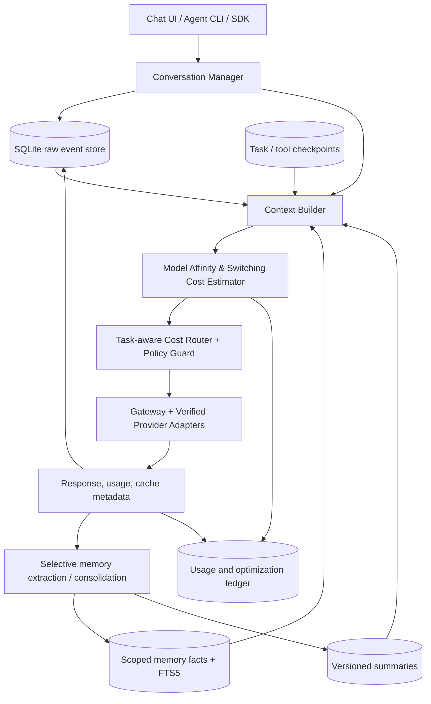

# Universal Shared Memory & Memory-Aware Cost Routing

> **Status:** Withdrawn · not pursued (ADR-028); kept for reference · reviewed 2026-11-11 · order: [ROADMAP](ROADMAP.md) · built: [Implementation Status](IMPLEMENTATION-STATUS.md)

> **Not pursued (owner, 2026-11-11, ADR-028):** the app hosts no chat of its own, so the app-owned conversation store, Memory & Context screen and per-turn model affinity below are not planned. Kept for reference. What tasks need is built: the bounded failure summary handed to the next step, and gateway session affinity (P0-4).


> Design proposal v1.0 — 2026-11-11. **Not implemented.** Complements the current gateway-first decision (ADR-016), not a replacement for it.
>
> Product goal: **Pygg is an AI Cost Optimizer for everyday users**, not merely a coding agent runner. People should ask a question normally; Pygg chooses a connected model automatically and preserves continuity across providers without asking users to select a model each turn.

## Review correction — ownership boundary and cache-stable epochs (2026-11-11)

**Authoritative boundary:** two modes have different ownership contracts, as agreed in [Claude review reconciliation](reviews/2026-11-11-review-response.md):

1. **App-owned Auto Chat:** Pygg owns raw conversation events and is permitted, under user privacy controls, to build scoped memory/context packages and hand off at **clean turn boundaries**. Keep already-sent cache-eligible prefix byte/token-stable within a pinned model/account epoch; append new messages. Versioned compaction may occur **at explicit checkpoints** only, with cache reset/rehydration cost measured. Never silently regenerate/reorder stable prefix each turn.
2. **Opaque external CLI/IDE gateway:** client owns its own history/compaction/tool IDs. Gateway **does not automatically inject memory, rewrite history, compact existing client prompts or synthesize a conversation**. It can record route metadata/usage, pass compatible messages transparently and maintain affinity only when there is an **explicit authenticated session identifier**. If no supported session ID is present, avoid inventing one from system-prompt hashes and do not claim cross-turn continuity.

**Selective memory extraction budgets:** no LLM call after every turn by default; batch incremental new events only with user consent, configurable input/token/spend cap and a separate ledger category `memory_extraction`. Any model classifier is absent from P0; later classifier input <=2k tokens per decision, run at meaningful classification boundaries (start, explicit topic change, failure), not full context per turn.

**Cache test gate:** native same-format Anthropic passthrough and real provider cache read/write observations come **before** claiming compression or handoff savings. Unknown costs remain unknown.

Read the current [Roadmap](ROADMAP.md) for priority; this memory design is **not pursued** (see the note at the top).

## 1. Problem and invariants

- Switching GPT ↔ Claude ↔ Gemini ↔ Ollama often forces the next model to consume the entire history or lose important context.
- Cache reuse is generally model/provider-specific; cross-provider KV/prefix cache sharing must **not** be assumed.
- Model outputs and tool calls use different schemas. Hidden reasoning, proprietary server-side state and provider-hosted artifacts may be nonportable.
- Memory extraction, embeddings, context compaction and retry calls also spend tokens; they must be included in the savings ledger.
- **Source of truth:** immutable raw conversation events + tool results + references to original attachments. Summaries, facts and indexes are derived, versioned and rebuildable.
- No invisible personality or decision changes when models switch. The interface normally runs in `Auto` without prompting for model selection, but respects user cost, data and action approval policies.
- User must be able to view, correct, export, delete or disable long-term memories independently from retaining a conversation.
- Routing decision is **quality-, privacy-, cache- and switching-cost-aware**, not an unconditional "use free first".

## 2. Proven open-source designs to study

These are engineering references, **not measured evidence of savings inside Pygg**. Check current licenses and upstream revisions before copying code.

| Project | Source | Mechanism worth learning | Adoption approach |
| --- | --- | --- | --- |
| Mem0 | https://github.com/mem0ai/mem0 | Fact extraction, update/deduplication, semantic and lexical retrieval | Reimplement a minimal, user-scoped extraction/retrieval pipeline in Rust; don't require the hosted service |
| OpenCode | https://github.com/anomalyco/opencode | Conversation compaction, continuity summary, context/token budgeting | Study its compaction boundaries and preserve enough recent turns; add independent regression tests |
| Letta | https://github.com/letta-ai/letta | Persistent agent state, shared memory blocks, versioning | Borrow scope, provenance and versioning concepts; don't import its full agent runtime |
| LangGraph | https://github.com/langchain-ai/langgraph | Thread checkpoint and long-term store separation | Adopt checkpoint semantics on local SQLite without running a Python workflow service |
| Aider | https://github.com/Aider-AI/aider | Repository map, symbol relevance, token-budgeted retrieval | Optional coding workspace context provider; not necessary for consumer chat MVP |
| Graphiti | https://github.com/getzep/graphiti | Temporal facts, changing relationships, validity windows | Later stage; only if temporal retrieval benchmarks justify complexity |
| Mem0 benchmarks | https://github.com/mem0ai/memory-benchmarks | LoCoMo, LongMemEval and BEAM-style memory evaluation | Adapt test cases and record exact task definitions, models, graders and pricing |

**Evidence tiers:** (1) source code/mechanism exists, (2) tests and reproductions run locally, (3) benchmark methodology is reproducible, (4) improvement measured in Pygg. Upstream vendor-reported benchmark numbers must not be advertised as our performance. Neither automated checks nor an LLM judge alone prove semantic correctness.

## 3. Architecture



- **Conversation Manager** owns one portable thread ID. Provider-specific session/message IDs are foreign references, never the canonical conversation ID.
- **Canonical message format** supports roles, content parts (text/image/file refs), tool invocation/result IDs, timestamps, provenance, privacy scope, provider format snapshot and explicit assistant-visible outputs. Keep lossless raw payload blobs beside normalized records where permitted.
- **Context Builder** chooses instructions, latest turns, relevant facts, current conversation summary and, for coding, symbol/file snippets within a declared input-token budget.
- **Memory Layer** stores durable user-approved facts/preferences/project decisions with sources, confidence and validity; SQLite FTS5 first, vector retrieval only after benchmarks demonstrate benefit.
- **Affinity Estimator** calculates incremental cost of staying versus switching, including context rebuild, cache hit opportunities, summary generation, expected next-turns and fallback.
- **Gateway** performs format transformations only on explicitly contract-tested adapter pairs; unknown capabilities mark a route ineligible.
- **Checkpoints** serialize visible tool/task state when safe; never claim ability to transfer hidden chain-of-thought, proprietary tool handles or provider KV cache.
- **Consumer chat mode** and **developer task mode** share the memory infrastructure, but have distinct routing, verification and permissions. The existing Git worktree isolation applies to code-editing tasks, not ordinary conversation.

## 4. Memory tiers and retrieval policy

| Tier | Contents | Persistence | Default context policy |
| --- | --- | --- | --- |
| L0 Raw history | Original messages, raw provider envelopes, attachments refs, tool traces | Retained per user settings | Searchable, never blindly replay full history |
| L1 Recent window | Current turns + unresolved references | Per conversation | Include when needed, with token cap |
| L2 Conversation summary | Objective, constraints, decisions, open questions, state, relevant references | Versioned snapshot | Include only if longer thread requires it |
| L3 Long-term facts | Preferences, persistent goals, stable relationships/decisions, contradictory/superseded facts | User-scoped with opt-out | Retrieve top relevant, cite originating event internally |
| L4 Work state | Tool status, task stages, files, diffs, checkpoints | Workspace/task-scoped | Include only when resuming affected task |

**Default retrieval order:** recent turns → short continuity summary → lexical retrieval (FTS5) of exact user decisions/terms → optional semantic retrieval → source verification → dedup/trim → fit budget. Never conflate a speculative assistant statement with a confirmed user preference.

**Memory lifecycle:** detect candidate facts → classify privacy/scope → verify provenance → insert/update/supersede → retrieval with confidence and freshness → user edit/delete → asynchronously rebuild derived indexes. For high-risk personal categories or sensitive workspaces, prefer opt-in memory and explicit retention controls.

**Contradictions:** record `supersedes_memory_id`, `valid_from`, `valid_to`, `source_event_id`; the newest claim is not always correct without user confirmation. Keep deleted items out of subsequent prompt packages and ensure derived indexes are purged.

## 5. Context handoff algorithm

When a new user message arrives:

1. Persist user input under the existing `conversation_id`, including attachment references and privacy scope.
2. Detect task intent, hard capability requirements and whether the topic continues the current conversation.
3. Build a **minimum viable context package**: relevant system/developer instructions, recent turns, concise current-state summary, cited facts and current message; enforce exact source ordering and token allowance.
4. Form candidate models solely from connected and eligible accounts; score **Stay** with cache and conversation continuity, and **Switch** with additional rehydration and expected validation costs.
5. Stay when switching advantage is not robust or current tool operations require pinned state; otherwise switch at a clean turn boundary.
6. Adapt canonical messages to selected provider; reject unsupported multimodal/tool/stream conversions rather than silently dropping content.
7. Save answer, provider usage and outcome. Update summary/facts **selectively**, not via an LLM call after every message.
8. If the response is poor, escalate with an explicit reason and bounded retries; user budget/privacy approval rules always apply.

**Suggested neutral context package (illustrative, not a hard-coded provider prompt):**

```json
{
  "conversation_id": "local-thread-id",
  "current_goal": "Reduce AI cost while keeping answer quality",
  "decisions": [{"text": "Auto-select model each turn", "source_event_id": "event-42"}],
  "unresolved": ["Cross-provider memory strategy"],
  "recent_messages": ["..."],
  "relevant_memories": [{"text": "...", "source_event_id": "event-12"}],
  "current_user_message": "...",
  "tool_state": null,
  "token_budget": {"hard_limit": 4096, "reserved_output": 1024}
}
```

For code agents, a separate handoff schema carries objective, affected files, checks, last failing test, branch/worktree ref and next action. No tool state is asserted complete unless checkpointed and verified.

## 6. Model affinity and true cost comparison

Define per-candidate incremental expected cost over the next turn or short planning horizon:

`C(model) = billed_input + billed_output + cache_miss_penalty + context_rehydrate + summarization + retrieval/embedding + validation + retries + expected_future_switches + local_operating_cost`

Use provider-reported cache token metrics where available and learned local estimates only when labeled. Subscription-window consumption is **not** silently converted into USD. A local API cost of $0 does not mean zero electricity/latency cost.

Decision policy:

- **Stay** if current model satisfies capability/privacy requirements and switching has uncertain or low estimated benefit.
- **Switch** when candidate is eligible and conservative expected savings exceed a configurable hysteresis threshold after handoff overhead.
- **Compact & Switch** if the current context is large and a bounded, evidence-preserving summary remains adequate; summarize only when expected benefits exceed compaction cost.
- **Escalate** only for inadequate answer quality/capability or hard provider failure; never silently spend above configured approval limits.
- Do not switch amid unresolved tool calls, partial streams, provider-specific reasoning state or agent execution attempts.
- Explicitly separate **token reduction** from **money saved** and **quality retained**.

**Model scoring must be empirically calibrated.** A cheap model repeating the task three times may cost more overall; underpowered free models must not be used merely to make a savings metric look good.

## 7. Data model extensions (SQLite, proposal)

```text
conversations(id, owner_id, workspace_id?, title, privacy_class, created_at, updated_at)
conversation_events(id, conversation_id, seq, role, parts_ref, raw_provider_ref?,
                    provider_id?, model_id?, tool_call_id?, token_count?, timestamp)
conversation_summaries(id, conversation_id, from_seq, through_seq, text,
                       version, source_event_ids, generator_model_id?, token_cost?, created_at)
memory_facts(id, owner_id, workspace_id?, conversation_id?, kind, content,
             source_event_id, confidence?, valid_from?, valid_to?,
             supersedes_memory_id?, privacy_class, user_approved, deleted_at?)
memory_fts (FTS5 virtual table over eligible non-deleted memory text)
context_packages(id, conversation_id, target_model_id, included_event_ids,
                 included_memory_ids, summary_version?, estimated_tokens,
                 actual_tokens?, package_hash, created_at)
model_handoffs(id, conversation_id, from_model_id?, to_model_id, turn_seq,
               reason, expected_stay_cost?, expected_switch_cost?,
               actual_cost?, cache_hit_tokens?, outcome, created_at)
provider_cache_observations(id, provider_id, model_id, account_id, prompt_hash?,
                            cache_read_tokens?, cache_write_tokens?, ttl?, recorded_at)
task_checkpoints(id, task_id, attempt_id, state_ref, verified_at, created_at)
memory_audit_events(id, owner_id, memory_id, action, source_event_id?, timestamp)
```

Use migrations consistent with the existing `db.rs`; unique per-thread `seq`, foreign keys, retention cascades, and secure attachment refs. Store secrets separately in the OS vault. Any background index refresh respects delete requests and privacy scope. A schema diagram is a contract proposal, **not an implemented migration**.

## 8. Privacy and provider boundaries

- Core memory stays local by default, under the user's control; a model receives **only** a scoped, minimized Context Package on each request.
- User/profile/workspace memory namespaces are isolated; do not leak one workspace's private content into another conversation.
- Capture provider data-use/training terms with source/check time; sensitive data cannot be routed to providers that fail policy.
- Export, inspect, edit, disable long-term extraction, delete conversations, delete individual memories, and regenerate summaries/indexes without the deleted data.
- Tool outputs and retrieved documents are untrusted data; neither can instruct memory policy changes or grant elevated permissions.
- Hide model names by default in everyday Auto chat, but surface an optional "Why this model?" panel and privacy/usage trace.
- Provider authentication/subscription terms are respected; do not scrape or share session tokens.

## 9. Product UI additions (progressive disclosure)

### Consumer-first Chat (new primary flow for general users)

- Main screen: chat list/sidebar, input, attachments, one **Auto** selector with optional strategy `Save More / Balanced / Quality`.
- Default: no pre-send model pick and no questions about task complexity or agent choice.
- Show selected model, reason and actual money/token usage *after* response in an expandable inspector.
- Cross-provider switches appear only if the user opens the details, except when capability/privacy/spending needs approval.
- Continuing a conversation must not produce a new thread or discard confirmed decisions.

### Memory & Context (Settings screen)

- Inspect recent and durable memories, originating conversation/source, scope and date.
- Pause/disable long-term extraction; delete, edit, import/export and clear scoped data.
- Inspect context package size, compaction history and switching/cache metrics.
- Privacy controls per provider and per workspace; default local data retention.
- Be explicit that enabling cross-provider context means selected conversation snippets are **sent** to the target provider.

### Developer Task mode

Keep existing `Tasks → Plan → Run → Result` and Git worktrees. Add context package inspector for each stage, checkpoint/resume and model affinity between attempts (never switch within an active attempt). Consumer chat and task runner can coexist through a mode switch; do not silently replace the existing navigation before screen review.

## 10. Evaluation and benchmark plan

Run reproducible tests with pinned model IDs, prices, source prompt IDs, random seeds where supported, consistent answer rubric and fixed limits. Avoid using subjective LLM grading as sole source of truth.

| Experiment | Model selection | Context policy | What it isolates |
| --- | --- | --- | --- |
| A: same/full | Pinned | Full history within limit | Reference continuity and cost |
| B: same/compact | Pinned | Recent + versioned summary | Benefit/cost of compaction |
| C: cross/full | Switch every specified boundary | Full history within limit | Provider handoff fidelity |
| D: cross/shared | Switch every specified boundary | Retrieved memory + compact context | Shared memory trade-off |
| E: auto-affinity | Router decides | Budgeted context package | End-to-end policy cost / quality |

Use short/mid/long chats; old-fact recall, changed decisions, follow-up references, multilingual turns, file mentions, tool results, unavailable models, expired cache, privacy-denied candidates and provider format mismatch. Include tool/coding tasks with deterministic checks separately from consumer chat quality tasks.

Measure **answer accuracy/continuity**, contradiction rate, retrieved-fact citation fidelity, p50/p95 latency, input/output/cache tokens, extraction/summary/embedding tokens, total spend including retry, manual correction burden, model switches and savings versus baseline.

Proposed release gates (targets to tune after trials): no known high-severity cross-workspace leak; deterministic coding checks preserved; zero unapproved paid attempts; no systematic continuity regression across switching; improvements must use bootstrap confidence intervals and a fixed evaluation set. Do not market percentage savings without controlled reproducible evidence.

## 11. Implementation order aligned with gateway-first ADR-016

| Step | Scope | Dependency | Priority |
| --- | --- | --- | --- |
| G0 | Existing gateway, model catalog, usage ledger, client contracts | Current roadmap | P0 |
| M1 | Canonical conversation events + SQLite raw store | G0 transport types | P0 |
| M2 | Context Builder (recent turns, summary, budget), adapter handoff | M1 | P0 |
| M3 | Cache observations + model affinity and hysteresis | G0 + M2 | P0 |
| M4 | Consumer-first Auto Chat UI, model reasoning inspector, Memory & Context controls | M2 + M3 | P1 |
| M5 | Long-term fact extraction, FTS5, provenance and deletion | M1 + settings | P1 |
| M6 | Cross-provider memory/cost benchmark harness | M2–M5 | P1 |
| M7 | Optional vector search, temporal graph, agent checkpoint integration | Measured need | P2 |

Don't insert memory extraction in the critical path of every message; use bounded opportunistic processing, recoverable work queues and explicit user controls.

## 12. Open risks and decisions to validate

1. **Canonical normalization fidelity:** messages, tools, images, thinking metadata, context cache behavior and partial streams vary by provider; maintain raw payload and enforce compatibility tests.
2. **Sensitive memory:** default opt-in/out per locality and data class; specify exact deletion/retention semantics.
3. **Cost model uncertainty:** use hysteresis and labeled confidence, not false precision.
4. **Model quality:** automatic routing on everyday questions needs a stronger semantic evaluation methodology than code test pass/fail.
5. **Memory extraction reliability:** distinguish user assertions, assistant guesses, obsolete facts, external-source injections and corrections.
6. **Context window limits:** compaction must occur before overflow and respect output reserve; failure must have a safe fallback.
7. **Product scope:** adding everyday chat is a deliberate expansion of the coding-first UI; prototype both modes before rearranging all six navigation destinations.

### Acceptance criteria for first shippable shared-memory slice

- One conversation survives a GPT/Claude/Gemini/local switch, provided required message capabilities are supported by both adapters.
- User can inspect the exact facts and recent context that were sent on a cross-provider handoff.
- No change to an active tool-call/agent attempt mid-run.
- Missing capability or unsafe privacy destination blocks switching with a reason.
- Context summary is versioned, can be reconstructed from raw events and isn't accepted when its source is stale.
- Accounted cost includes compaction and cache misses, and reports unknown values honestly.
- Auto chat does not ask user to choose a model on normal turns.
- User can disable/delete extracted memory and the data is excluded from subsequent context builds.

## OmniRoute-informed context/cost interactions

The [OmniRoute adoption decision](OMNIROUTE_FEATURE_RESEARCH.md) reinforces **safe session deduplication, prompt-cache affinity and bounded context relay**. Implement deterministic repeated-event dedup separately from semantic memory compaction. Avoid lossy rewriting of system/tool schemas, recent turns, active tool calls or code edits. Model switching must compare cache miss, summary and rehydration costs; there is no portable KV cache across providers. A memory handoff is never assumed to reproduce hidden reasoning.
